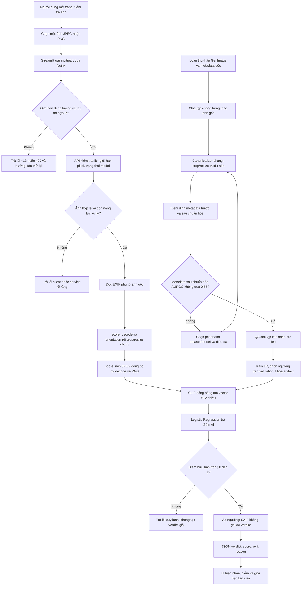

# Feature Specification: RealCheck System — baseline trước họp nhóm

**Feature Branch đề xuất**: `luc/realcheck-system-baseline` (không khẳng định nhánh đã được tạo).  
**Created**: 2026-11-01.  
**Status**: Draft baseline để review; kiến trúc và bất biến hoàn chỉnh, tham số tại các decision ID cần nhóm chốt.  
**Input**: Yêu cầu đặc tả toàn hệ thống RealCheck và phản biện chống shortcut metadata, Double JPEG, training-serving skew.  
**Tài liệu liên quan**: [plan.md](plan.md), [tasks.md](tasks.md), [constitution](../../memory/constitution.md).

## 1. Nguồn yêu cầu và hiệu lực

| Nguồn | Nội dung áp dụng |
|---|---|
| `docs-local/final_realcheck (3).pdf`, mục 1–6 | Bài toán, core/nâng cao, dataset, CLIP + LR, API, Nginx, Locust, QA, mốc demo |
| `docs/technical-report/report.tex` và `RealCheck_Technical_Report_Week1.pdf` | Phạm vi tuần 1; trạng thái skeleton và CI từng bỏ qua pytest; không phải bằng chứng nghiệm thu |
| `docs/test-plan.md` | TC-01–TC-16 tiếp tục làm nền; TC-17 dung lượng file được thay bằng FR-D04–D07 dưới đây |
| `docs/bug-report-template.md`, `docs/README.md` | Báo lỗi tái hiện được, tài liệu tiếng Việt |
| `.github/CODEOWNERS`, README repo/thư mục, CI | Quyền review theo đường dẫn, trách nhiệm triển khai và công cụ kiểm tra |
| Yêu cầu người dùng ngày 2026-11-01 | Bắt buộc AUROC metadata ≤ 0.55, crop/resize trước nén, chuẩn hóa bên trong `score(image)`; ưu tiên hơn baseline dung lượng file cũ |

Bài [Fake or JPEG? — Grommelt et al.](https://arxiv.org/html/2403.17608v2), thuộc CEGIS/ECCV 2024, phân tích thiên lệch JPEG và kích thước trong GenImage. Bài báo là cơ sở cảnh giác với shortcut; **ngưỡng AUROC 0.55 và thiết kế kiểm định dưới đây là yêu cầu dự án trong lần giao việc này, không phải ngưỡng được trích từ bài báo**. Crop/resize trước nén không được coi là chứng minh loại bỏ hoàn toàn dấu vết nén trước đó.

Các sách AI Engineering, Deep Learning, NLP, AI, tài liệu FastAPI trong `docs-local` là tham khảo kỹ thuật. `Technical_Report.pdf` nghiên cứu KNN/PCA/LDA, dự án IS402 thương mại điện tử và mẫu LaTeX không phải nghiệp vụ RealCheck; không nhập kiến trúc của chúng vào hệ thống này. Hình/logo và `.sty` không quy định hành vi sản phẩm.

**Xung đột cần đồng bộ**: constitution 1.0.1, README `data/` và TC-17 vẫn mô tả baseline dung lượng file. Yêu cầu mới bỏ phép kiểm đó. T001 phải sửa đồng bộ trước triển khai; ba file này không tuyên bố constitution đã được sửa hay nhóm đã chấp thuận tham số còn mở.

## 2. Tổng quan bài toán và mục tiêu

Người dùng gửi một ảnh; hệ thống trả kết luận có thể là Ảnh thật, Ảnh AI hoặc Chưa chắc, điểm AI từ 0 đến 1, thông tin máy chụp khi có và lý do tiếng Việt. Đây là công cụ hỗ trợ nhận định cho học tập, không chứng nhận nguồn gốc hoặc tính xác thực tuyệt đối của ảnh.

Mục tiêu cốt lõi cố định:

1. Phục vụ một luồng upload → kiểm tra → suy luận → phản hồi JSON → hiển thị qua UI trên CPU.
2. Dùng CLIP ViT-B/32 đóng băng và Logistic Regression, giao diện `score(image) -> float`, artifact `models/clip_probe.joblib`.
3. Không chấp nhận chất lượng giả tạo từ metadata hoặc định dạng. Gate sau chuẩn hóa phải đạt AUROC metadata ≤ 0.55 với protocol cố định, không thay bằng accuracy dung lượng file.
4. Không có đường suy luận bỏ qua crop/resize rồi nén. Cùng một ảnh gốc phải qua cùng canonicalizer ở train và serving, đúng một lần mỗi lần tạo đầu vào CLIP.
5. API, Nginx, Streamlit được đóng gói Docker Compose; có pytest, QA dữ liệu độc lập và Locust từ máy ngoài server.
6. Đạt mục tiêu Accuracy GenImage test ≥ 90% với protocol công khai; nếu không đạt phải báo không đạt, không bỏ kiểm định metadata hoặc chọn lại ngưỡng trên test để cứu số đo.

Core bao gồm API, Streamlit, Docker, Nginx, pytest, Locust. Prometheus/Grafana chỉ bắt đầu sau core chạy server và có baseline tải. Ngoài phạm vi baseline: nhận diện chỉnh sửa/ELA/heatmap, C2PA, Redis queue, ONNX, huấn luyện CLIP, user account, database lưu ảnh và CD tự động. CI GitHub Actions vẫn bắt buộc.

Mốc kế hoạch gốc: localhost 01/11/2026; core server + Locust 08/11; chốt tính năng 12/11; nộp 15/11. Đây là mục tiêu lịch, không xác nhận đã hoàn thành. Ba Phase trong tasks là thứ tự kỹ thuật, không đồng nhất với ba tuần.

## 3. Luồng nghiệp vụ tổng thể

## 4. User Scenarios & Testing

### US1 — Phân tích một ảnh qua API, P1 — `/app/`, `/models/`

Là người dùng API, tôi gửi một ảnh và nhận kết luận có lý do, để cân nhắc ảnh có thể do AI tạo. Đây là lát cắt MVP: kiểm thử được qua `/docs` mà chưa cần Streamlit.

**Independent Test**: gọi API với fixture thật và model stub để xác minh hợp đồng; sau đó chạy cùng hợp đồng với artifact thật, kiểm tra điểm hợp lệ, không ép model phải nhận đúng từng ảnh bất kỳ.

**Acceptance Scenarios**:

1. **Given** ảnh hợp lệ và model sẵn sàng, **When** gửi đúng một file, **Then** HTTP 200 có đúng bốn trường nghiệp vụ, điểm hữu hạn trong `[0,1]`, reason không rỗng.
2. **Given** stub lần lượt trả 0.1, 0.3, 0.5, 0.7, 0.9, **When** phân tích, **Then** kết luận lần lượt thật, chưa chắc, chưa chắc, chưa chắc, AI.
3. **Given** cùng điểm nhưng ảnh có/không EXIF, **When** tạo phản hồi, **Then** verdict giống nhau trong 100% ca; chỉ bằng chứng EXIF/lý do thay đổi.

### US2 — Dataset và audit metadata tái lập, P1 — `/data/`, `/scripts/`

Là Loan và QA, tôi cần dataset có nguồn gốc và kiểm định trước/sau để không huấn luyện detector dựa vào dấu vết quy trình tạo file. Kiểm thử độc lập trên fixture có thiên lệch cài sẵn, không cần API.

**Independent Test**: tạo manifest, audit, canonicalize, audit lại, QA chạy từ raw trên checkout khác; so fingerprint, split và báo cáo.

1. **Given** JPEG thật và PNG AI cùng nhãn theo nguồn, **When** audit raw, **Then** lưu AUROC và phân bố metadata gốc, kể cả khi AUROC > 0.55; không giả vờ raw sạch.
2. **Given** cùng bộ ảnh đã chuẩn hóa bằng protocol khóa, **When** chạy audit held-out, **Then** mọi probe/slice hợp lệ sau chuẩn hóa có `max(AUROC, 1-AUROC) <= 0.55`; nếu vượt thì exit khác 0 và chặn model.
3. **Given** cùng ảnh hoặc biến thể nén ở nhiều nguồn, **When** chia tập, **Then** số nhóm ảnh gốc xuất hiện ở nhiều split bằng 0.

### US3 — Ảnh điện thoại và train-serving parity, P1 — `/models/`, `/tests/`

Là người dùng, tôi muốn gửi JPEG điện thoại cỡ 4000px hoặc PNG chưa qua nén JPEG mà không tự resize. Là Kiệt, tôi cần CLIP nhận đúng phân phối đầu vào đã train.

**Independent Test**: spy canonicalizer và encoder trong unit test, dùng JPEG 4000×3000, PNG cùng nội dung và ảnh nhỏ; không cần tải CLIP thật.

1. **Given** JPEG 4000×3000 nằm trong giới hạn byte/pixel được chốt, **When** gọi `score(image)` trực tiếp hoặc qua API, **Then** mỗi lượt gọi đúng một canonicalizer, thứ tự geometry trước JPEG encode, một lần CLIP và điểm hữu hạn.
2. **Given** cùng bytes gốc, profile và môi trường codec, **When** lấy tensor từ pipeline trích xuất train và `score`, **Then** tensor bằng nhau phần tử theo phần tử; config hash giống nhau.
3. **Given** processed JPEG dùng để kiểm định, **When** kiểm tra luồng train, **Then** không dùng nó làm đầu vào raw của `score` để nén lần thứ hai.

### US4 — UI dễ hiểu, P2 — `/streamlit/`

Là người dùng không biết API, tôi kéo thả ảnh, bấm kiểm tra và hiểu kết quả, kể cả Chưa chắc. Kiểm thử độc lập bằng HTTP stub.

1. **Given** một ảnh được chọn, **When** bấm kiểm tra, **Then** chỉ có một request chủ động, có trạng thái đang xử lý và không hiển thị kết quả cũ như kết quả mới.
2. **Given** phản hồi hợp lệ, **When** render, **Then** hiển thị nhãn tiếng Việt, điểm AI, EXIF, lý do và giới hạn mô hình; không diễn giải score như xác suất chắc chắn ảnh là giả.
3. **Given** API trả 429/503/504 hoặc mất kết nối, **When** render, **Then** hiện hướng dẫn tiếng Việt, không có nhãn thật/AI mới và không tự retry upload.
4. **Given** báo cáo đánh giá tồn tại, **When** mở Kết quả đánh giá, **Then** xem được dữ liệu/model/profile phiên bản nào, metrics và tỷ lệ Chưa chắc; không có báo cáo thì hiện chưa có số đo.

### US5 — QA và vận hành có bằng chứng, P1 — `/tests/`, `/locust/`, `/nginx/`

Là Lực/Quang, tôi cần kiểm tra tải và lỗi có thể tái hiện để biết giới hạn server trước demo. Mock unit test, integration thật và tải có mục đích khác nhau.

1. **Given** checkout có mã/test, **When** CI chạy, **Then** pytest thực thi thật, ít nhất 15 ca core và coverage `app/ >= 70%`; lỗi làm `ci-ok` đỏ.
2. **Given** một IP gửi vượt 10 request/giây qua cổng API, **When** chạy rate test riêng, **Then** quan sát 429 và không có 500 do giới hạn; test không trộn với kiểm tra năng lực suy luận.
3. **Given** workload tải cố định, **When** chạy smoke/load/stress/soak từ máy khác, **Then** có CSV/HTML, cấu hình máy, trạng thái lỗi tách loại và bằng chứng so với SLO đã được chốt sau baseline.

## 5. Functional Requirements

### `/data/` và kiểm định dữ liệu

- **FR-D01**: lấy GenImage khoảng 3.000 real + 3.000 ai làm tập chính; số lượng là kế hoạch, phải ghi số thực nhận. CIFAKE chỉ smoke pipeline. Ảnh tự chụp/tự tạo 100–200 mỗi nhóm và Zalo 50–100 là bộ đánh giá thực tế dự kiến, không trộn vào train.
- **FR-D02**: giữ raw bất biến, nhãn `real=0`, `ai=1`; `labels.csv` có ít nhất `filepath,label,source,split`. Manifest mở rộng có `sample_id`, hash bytes gốc, `group_id`, đường dẫn processed, profile hash và trạng thái lỗi; ID không được làm feature.
- **FR-D03**: decode/orientation/RGB → crop/resize về cùng kích thước → JPEG encode chung cấu hình → decode cho CLIP. Cấm re-encode full-resolution trước geometry; metadata biểu diễn nguồn không đi vào tensor. Biến thể cùng ảnh gốc ở cùng group/split.
- **FR-D04**: thu metadata từ bytes raw trước biến đổi và metadata từ bytes canonical sau biến đổi. Hai bảng nối bằng sample ID trong audit; post probe không được đọc ngược cột raw hoặc provenance.
- **FR-D05**: probe chỉ đọc metadata hình ảnh, không dùng pixels/CLIP embeddings, dung lượng file, filename/path, label, split, nguồn/generator hoặc ID. Feature family bắt buộc: format thực, width/height/aspect ratio, mode/channel, EXIF presence và trường thiết bị đã whitelist, JPEG quantization/subsampling khi đọc được; missingness là feature cần audit. Metadata cá nhân đầy đủ không xuất báo cáo công khai.
- **FR-D06**: audit hai view bằng cùng split/group protocol và family feature, extractor đọc được định dạng thực. Raw là chẩn đoán; gate cứng áp dụng **post**: `A_eff = max(A,1-A) <= 0.55`. Inversion guard ngăn AUROC 0.1 bị hiểu sai là không rò rỉ. Trường hợp không có hai lớp/thiếu dữ liệu/NaN không được pass. Không lấy trung bình để giấu probe/slice fail.
- **FR-D07**: fit encoder/scaler/imputer/probe trên audit-train, chọn classifier/hyperparameter trên audit-validation, báo kết quả trên audit-test khóa riêng. Audit-test không phải model-test cuối; không thử đi thử lại audit-test để chọn preprocessing mà không version lại vòng đánh giá. Lưu seed, config hash, số lượng, score từng mẫu và bootstrap CI. CI là thông tin bất định, không thay ngưỡng điểm 0.55.
- **FR-D08**: chạy độc lập bởi Lực trước khi bàn giao dataset cho Kiệt; pipeline fail phải có báo lỗi và bằng chứng; không dùng baseline chỉ có dung lượng file làm gate thay thế.

### `/models/`

- **FR-M01**: CLIP ViT-B/32 đóng băng, vector 512 chiều, LR trả xác suất lớp có label 1 theo `classes_`, không mặc định cột thứ hai khi artifact sai schema.
- **FR-M02**: `score(image)` nhận bytes JPEG/PNG gốc hoặc đối tượng ảnh còn giữ định dạng/EXIF theo contract plan; tự chuẩn hóa nội tại bằng shared canonicalizer, tạo CLIP tensor và trả `float` hữu hạn `[0,1]`. Caller API/UI không cần và không được chuẩn hóa trước.
- **FR-M03**: code trích xuất feature train dùng cùng primitive tạo tensor với `score`; cùng dependency/profile; không đọc processed JPEG rồi encode lại. Đổi canonicalizer/QF/profile phải vô hiệu cache feature và retrain LR.
- **FR-M04**: artifact bundle chứa probe, CLIP revision, feature dimension, preprocessing profile/hash, nhãn, ngưỡng, dependency version và manifest hash; kiểm checksum/version khi load, tải từ nguồn tin cậy, không deserialize artifact từ upload người dùng.
- **FR-M05**: load một lần mỗi inference worker, warmup trước ready; inference mode/eval, không gradient; reject artifact không khớp profile. Không tải model trên request đầu.
- **FR-M06**: ngưỡng khởi đầu 0.3/0.7 gồm hai biên vùng Chưa chắc, chỉ tune trên validation. EXIF chỉ bằng chứng phụ; không dùng EXIF predictor làm detector chính.

### `/app/`

- **FR-A01**: `POST /v1/analyze` nhận một multipart `file`; không hỗ trợ URL fetch, batch hoặc archive. Kiểm bytes, decoded format/pixel/frame; trả lỗi xác định cho missing/empty/corrupt/oversize/unsupported.
- **FR-A02**: response thành công có `verdict,score,exif,reason`; thiếu EXIF trả `Không có thông tin máy chụp`. Enum/error choices chờ D05 nhưng semantics ba trạng thái cố định.
- **FR-A03**: giữ event loop phản hồi trong khi decode/inference CPU chạy ở execution boundary hữu hạn. Có admission control và deadline; không tạo thread/process/queue tăng vô hạn khi nhiều request hoặc timeout.
- **FR-A04**: model chưa ready/busy trả lỗi service; timeout trả lỗi riêng; inference lỗi không biến thành 200 hoặc score giả. Không giải phóng slot khi công việc nền thực tế vẫn đang chạy mà chưa kiểm soát.
- **FR-A05**: `GET /health` kiểm ready model nhẹ, không chạy CLIP mỗi lần; `/docs` và `/openapi.json` mô tả hợp đồng; `/metrics` thuộc nâng cao, không phải điều kiện core.
- **FR-A06**: request ID, status, tổng thời gian, thời gian normalize/CLIP/LR, profile/model version được ghi có cấu trúc; không log bytes ảnh, EXIF GPS hoặc trace nội bộ vào response.

### `/streamlit/`, `/nginx/`

- **FR-U01**: hai trang Kiểm tra ảnh và Kết quả đánh giá; gọi API qua Nginx, không import model. Hiển thị lỗi HTTP/network, loading, không lặp request do rerun và không tự retry POST.
- **FR-U02**: score là điểm AI, không phải mức chắc chắn của tính xác thực. UI không đổi verdict theo EXIF và không cache ảnh của người trước sang session khác.
- **FR-N01**: mọi API bên ngoài qua Nginx; giới hạn tốc độ 10 request/giây mỗi IP, 429 cho rate limit. Không công khai cổng API/container hay Grafana trực tiếp.
- **FR-N02**: tối đa 5 MB nội dung file, giới hạn request body phải tính overhead multipart. Chọn đơn vị ở D06; gateway và API nhất quán, oversized là 413, không nhầm với 429.
- **FR-N03**: proxy timeout theo budget API; lỗi gateway không chứa traceback; cấu hình IP tin cậy, không tin `X-Forwarded-For` tùy ý từ Internet. Nginx phải hỗ trợ WebSocket của Streamlit.

### `/tests/`, `/locust/`, `/scripts/`

- **FR-Q01**: pytest unit/contract/integration/data/real-model phân nhóm rõ; CI mock không tải CLIP, pipeline release chạy test model thật khi artifact có sẵn, không skip rồi công bố đạt.
- **FR-Q02**: bắt buộc regression JPEG 4000px, PNG lossless, thứ tự crop/resize trước encode, normalize đúng một lần, train-serving parity và profile mismatch.
- **FR-Q03**: integration thật qua Nginx kiểm route/status/body limit/rate limit/timeouts/readiness/UI; model mock chỉ dùng fault injection, không dùng đo tải inference cuối.
- **FR-Q04**: script có CLI, exit code pass/fail, output versioned; validator JSON/test AUROC từ fixtures phải fail ở 0.550001 và pass ở 0.55, không rounding trước so sánh.
- **FR-Q05**: Locust smoke/load/stress/soak tách traffic hợp lệ và rate test; throughput chỉ tính 200 hợp lệ, không tính 429 vào năng lực model. QA chạy máy khác, lưu đủ CPU/RAM/worker/profile/dataset/payload mix.

## 6. Non-Functional Requirements

| ID | Cốt lõi cố định / phép đo | Thông số cần chốt |
|---|---|---|
| NFR-01 — Leakage | Post metadata `A_eff <= 0.55` với mọi probe/slice hợp lệ đã đăng ký; raw/post đều phải có số đo. Audit pass không chứng minh không còn shortcut pixel hoặc Double JPEG | D02–D04 chọn profile/probe và protocol |
| NFR-02 — Model quality | Accuracy nhị phân GenImage test ≥ 0.90; báo precision/recall lớp AI, confusion matrix, tỷ lệ Chưa chắc, tổng N. Model-test không tune | D08 chọn binary reporting threshold; ngưỡng ba trạng thái mặc định 0.3/0.7 |
| NFR-03 — Latency | p50/p95/p99 đo từ client ngoài server qua gateway trên request 200; tách warm steady-state, cold startup, 4xx/5xx và deadline | **D09 [NEEDS CLARIFICATION - Chờ chốt buổi họp]**: thử budget p95 1s / 2s / 5s trên máy CPU tham chiếu; chốt sau baseline, chưa là SLA |
| NFR-04 — Throughput | RPS 200 hợp lệ và tỷ lệ request bị từ chối phải báo riêng; không đánh đồng 10r/s/IP với năng lực suy luận | **D10 [NEEDS CLARIFICATION - Chờ chốt buổi họp]**: khảo sát 1 / 3 / 5 RPS mục tiêu, giữ offered load dưới rate limit mỗi IP; chưa cam kết |
| NFR-05 — Resource & timeout | admission/queue hữu hạn; không OOM hoặc chết process cha dưới stress; health hoạt động khi inference bận; báo peak/RSS sau soak | D07, D11, D12 quyết định limits, timeout và concurrency |
| NFR-06 — Security/privacy | Không thực thi file upload, không SSRF, không log nội dung ảnh/GPS/secret, không giữ ảnh sau request ngoài thời gian cleanup hữu hạn; không công khai model artifact | HTTP demo theo kế hoạch gốc; nếu đưa Internet có ảnh nhạy cảm phải quyết định TLS trước mở truy cập |
| NFR-07 — Testability | ≥15 pytest core, coverage `app/ >=70%`, Ruff check + format pass, zero leaked split groups, parity tuyệt đối tensor trong cùng runtime | Không phải thông số chờ họp |
| NFR-08 — Reliability | Không trả verdict thành công khi lỗi, không queue vô hạn, không retry storm; xác nhận recovery sau timeout/restart | D11–D12 chọn budget; soak theo plan là thí nghiệm có thông số cụ thể |
| NFR-09 — Reproducibility | manifest/profile/CLIP revision/seed/probe protocol/commit/hash dependency theo mỗi báo cáo; data QA khác người tạo | Độ ổn định tensor khác codec/CPU không được hứa bitwise; chỉ cùng môi trường mới kiểm tuyệt đối |

## 7. Edge Cases và Acceptance Criteria

Mọi ca dưới đây là bắt buộc. Các ca viện dẫn D-ID có hành vi cố định nhưng dữ liệu biên/thời gian lấy từ cấu hình được ký sau họp. Trước khi chốt, chúng là test contract có parameter, **không được ghi pass release** chỉ vì dùng giá trị thử nghiệm.

| ID | Given | When | Then định lượng / pass-fail |
|---|---|---|---|
| AC-01 | JPEG hợp lệ, service ready | POST một file | 200; bốn trường, score hữu hạn `[0,1]`, reason tiếng Việt không rỗng; 0 trường dữ liệu nội bộ thừa |
| AC-02 | Stub score `0,0.299999,0.3,0.7,0.700001,1` | Map verdict | Thật, thật, chưa chắc, chưa chắc, AI, AI; 6/6 đúng, không round trước quyết định |
| AC-03 | JPEG 4000×3000 thực, bytes dưới limit và pixels được D07 cho phép | Gọi score trực tiếp và API | Không yêu cầu caller resize; 1 normalize/1 encode mỗi đường, tensor đúng shape profile, finite score; không OOM |
| AC-04 | PNG lossless, grayscale hoặc RGBA hợp lệ | Score | Decode format thật; RGB policy chung; geometry → encode JPEG → decode → CLIP đúng thứ tự; không yêu cầu gán nhãn AI vì PNG |
| AC-05 | Một ảnh raw và profile khóa | Train extraction vs serving | `array_equal(train_tensor, serve_tensor)` true, config hash bằng nhau; spy không có encode thứ hai từ processed input |
| AC-06 | Mock encode và geometry ghi thứ tự | Chuẩn hóa GenImage JPEG/PNG | Trong 100% ca encode xảy ra sau geometry; output hai lớp cùng dimensions/QF/subsampling; không tuyên bố đã xóa mọi lịch sử JPEG |
| AC-07 | Fixture không EXIF và cùng pixels có EXIF | Cùng stub score | Verdict giống nhau; thiếu EXIF đúng chuỗi chuẩn; metadata GPS không xuất response/log |
| AC-08 | Thiếu file/zero bytes/text đuôi jpg/JPEG bị cắt cụt | Upload | 4xx theo D05, model call count = 0, không 500 và không trả score |
| AC-09 | File size bằng giới hạn và lớn hơn 1 byte; multipart overhead trong budget | Upload qua proxy và API trực tiếp trong test network | Bằng giới hạn đi tiếp nếu hợp lệ; +1 trả 413; response lỗi không có verdict |
| AC-10 | Dimensions ngay trên MAX_PIXELS hoặc image bomb header | Upload | 4xx có code, không cấp phát full raster vượt policy; service không chết; request nhỏ kế tiếp còn xử lý được |
| AC-11 | EXIF rotation, CMYK, ICC và PNG transparency | Chuẩn hóa | Deterministic theo policy D02; không double rotate; identical input/profile cho cùng tensor |
| AC-12 | GIF/animated PNG/multi-frame theo unsupported policy | Upload | Từ chối rõ ràng; không âm thầm lấy frame bất kỳ rồi nhận là hỗ trợ đầy đủ |
| AC-13 | Raw metadata có lệch format/kích thước | Audit raw rồi post | Raw metric được lưu dù >0.55; post dùng metadata lấy lại từ canonical bytes, không trộn raw provenance |
| AC-14 | Post audit hợp lệ có `A_eff=0.55` / `0.550001` / A=0.1 | Check gate | Lần lượt pass / fail / fail do inversion; test gate độc lập model classifier, không round |
| AC-15 | Audit-test thiếu một lớp, empty slice, NaN prediction hoặc sample trùng train | Audit | Exit khác 0; báo invalid hoặc fail, tuyệt đối không biến NaN thành 0.5/pass |
| AC-16 | Metadata có missing field hoặc toàn feature constant | Probe | Missing được encode không phụ thuộc nhãn; constant probe cho score 0.5 và ghi degenerate; gate chỉ hợp lệ khi control positive AC-17 pass |
| AC-17 | Synthetic control format/width dự đoán nhãn hoàn hảo, negative control nhãn cân bằng random seed khóa | Test audit harness | Positive control AUROC ≥0.95 và bị gate từ chối; negative control tập đủ lớn `A_eff<=0.55`; extractor không bị làm rỗng để qua gate |
| AC-18 | Một ảnh và các bản JPEG 90/70/50, Zalo có cùng lineage | Chia split | 0 group_id giao giữa train/val/test; duplicate/hash report đầy đủ; QA reproduce đúng manifest |
| AC-19 | Ảnh hợp lệ; stub trả NaN/Inf/-0.1/1.1 hoặc throw exception | POST | 5xx lỗi model xác định, 0 response 200, không lộ stacktrace |
| AC-20 | Artifact thiếu/hỏng hoặc profile hash sai | Startup/health/analyze | Không ready; health 503 hoặc process startup fail rõ; analyze không phục vụ bằng model khác ngầm |
| AC-21 | N inference slots đang bận | Request N+1 | Bị từ chối hoặc đợi bounded theo D12; không tăng queue/worker vô hạn; không block health event loop |
| AC-22 | Stub inference vượt MODEL_TIMEOUT | Gửi analyze rồi health và một request tiếp | Lỗi timeout theo D05 trong budget D11; không trả verdict; slot chỉ tái dùng khi workload cũ kết thúc hoặc bị terminate/join; recovery có bằng chứng |
| AC-23 | Một IP tạo burst vượt policy 10r/s | Rate scenario riêng qua Nginx | Có 429; Retry-After theo policy; không có 500 do rate config; mẫu dưới tốc độ chờ cửa sổ hồi phục xử lý lại được |
| AC-24 | Nginx upstream down hoặc API quá deadline | Gọi UI/API | Gateway 502/504 có lỗi rõ; UI không hiện kết luận mới; không tự retry POST |
| AC-25 | Model GenImage khóa, metadata gate pass | Evaluate model-test một lần | Accuracy binary ≥90%; metrics đủ, N rõ, tỷ lệ Chưa chắc mẫu số toàn tập; nếu thấp thì release quality fail |
| AC-26 | Ảnh nén và AI mới/điện thoại | Robustness evaluation | Có metrics riêng từng bộ và flip rate so ảnh cha; không bắt buộc accuracy 90% cho OOD và không giấu số suy giảm |
| AC-27 | Checkout sau triển khai | Ruff + pytest + coverage | ≥15 ca core thực thi, coverage app ≥70%, cả hai Ruff check pass; lỗi khiến ci-ok fail |
| AC-28 | Server warm, workload và SLO đã khóa sau baseline | Load rồi soak | p95/RPS/error/recovery/RSS so SLO đã ký; report tách 200/429/503/504; chưa ký SLO thì chỉ baseline, không kết luận SLA đạt |
| AC-29 | Hai session UI và một upload thành công trước đó | Session khác upload lỗi | Không lộ ảnh/kết quả session kia; không hiển thị kết quả cũ cho upload mới; 1 click chỉ một POST |

## 8. Key Entities và phép đo

- **ImageSample**: ID, raw hash, label, source, group, split; liên kết raw/processed, không sửa raw.
- **NormalizationProfile**: geometry strategy, target dimensions, interpolation, orientation, RGB/alpha policy, JPEG QF/subsampling/progressive, codec versions, profile hash. Mọi config ảnh hưởng tensor thuộc hash.
- **MetadataAudit**: view raw/post, extractor/probe version, protocol seed, train/val/test manifest hash, feature whitelist, AUROC/A_eff/CI/count từng slice và gate result.
- **ModelBundle**: CLIP revision, probe, classes, feature dimension, preprocessing hash, train manifest, threshold policy, checksums và metrics.
- **AnalysisResult**: verdict/score/exif/reason; request ID dùng header, không thêm trường trái response contract.
- **PerformanceRun**: commit, hardware, image mix, worker/threads, concurrency, duration, client location, RPS offered/200, distribution latency, status breakdown, CPU/RAM và SLO version.

Với `y=1` là AI, binary threshold báo cáo dùng D08, confusion matrix theo thứ tự `[real,ai]`; zero denominator precision/recall được ghi 0 kèm count. Tỷ lệ Chưa chắc = số điểm trong `[low,high]` / toàn bộ N. Có thêm accuracy trên các ca đã kết luận và coverage quyết định, nhưng không dùng chúng thay accuracy toàn bộ theo binary protocol. Metadata AUROC là chỉ số probe khác với CLIP detector.

## 9. Success Criteria và trạng thái nghiệm thu baseline

- **SC-01**: 100% ca AC-01–AC-24, AC-27, AC-29 có bằng chứng khi nghiệm thu core; không skip test bắt buộc.
- **SC-02**: post audit A_eff ≤0.55, không thiếu slice đã đăng ký; raw/post và control đầy đủ; không có group leakage.
- **SC-03**: feature cache/profile/artifact kiểm được lineage; test parity và điện thoại 4000px pass.
- **SC-04**: Accuracy GenImage model-test ≥90%, số liệu thực đo được lưu; OOD/ảnh nén báo riêng.
- **SC-05**: đủ smoke/load/stress/soak qua Nginx từ máy khác; SLO cụ thể chỉ xét sau quyết định D09–D12 và baseline.
- **SC-06**: bản trước họp hoàn thành khi ba tài liệu có đủ kiến trúc, nhiệm vụ, phụ thuộc, DoD và toàn bộ câu hỏi có owner/phương án. Điều này **không** đồng nghĩa phần mềm đã triển khai hoặc release pass.

## 10. Assumptions và dependency

Server CPU, dung lượng RAM chưa biết; không hứa p95/RPS trước đo. Model/dataset cần tải ngoài Git, nguồn tin cậy và checksum; tests nhỏ có thể sinh tại runtime. Test phone 4000px phải ở trong policy pixel được nhóm chọn, không bị cấm toàn bộ chỉ để làm nhẹ test. Score và chuẩn hóa không phụ thuộc tên file, thư mục nguồn hay nhãn.

Do Streamlit gọi API từ server, gateway thường chỉ thấy IP container Streamlit; không thể tuyên bố 10r/s của từng trình duyệt nếu chưa có cơ chế identity tin cậy. Baseline chấp nhận limit theo IP thực nhìn thấy và kiểm riêng nhiều session; không tin XFF do người dùng tự khai. Các lựa chọn thay đổi routing/identity phải review cùng Quang.

## 11. Danh sách câu hỏi kỹ thuật cần chốt trong buổi họp nhóm (Meeting Agenda)

Mỗi D-ID dưới đây có owner quyết định; kết quả ghi vào `docs/decisions/realcheck-baseline.md` kèm ngày, người review và rationale, sau đó sửa đồng bộ ba file/profile. Không dùng giá trị thử nghiệm như giá trị production mặc định.

### Quang — Backend & DevOps

- **D05 [NEEDS CLARIFICATION - Chờ chốt buổi họp]**: contract enum/error. Phương án A: `likely_real/uncertain/likely_ai`, error envelope riêng; B: `real/uncertain/likely_ai` để giữ ví dụ AI cũ. Gợi ý 422 thiếu field, 400 ảnh hỏng, 415 unsupported, 413 oversize, 503 busy/not-ready, 504 timeout; phương án khác dùng 422 chung cho nội dung ảnh sai. Chốt một bảng duy nhất cho UI/API/proxy.
- **D06 [NEEDS CLARIFICATION - Chờ chốt buổi họp]**: 5 MB là 5.000.000 hay 5.242.880 byte? Body allowance multipart thêm 64 KiB hay 128 KiB? File vẫn bị API giới hạn đúng 5 MB; body overhead không nới file limit.
- **D07 [NEEDS CLARIFICATION - Chờ chốt buổi họp]**: max pixel 16 / 24 / 32 megapixel; chọn theo RAM đo, hỗ trợ ít nhất JPEG 4000×3000. Có thể thêm max cạnh 8192 hoặc 10000; không thay thế pixel product check.
- **D11 [NEEDS CLARIFICATION - Chờ chốt buổi họp]**: model timeout 5 / 10 / 20 giây; proxy phải dài hơn tổng API budget và UI dài hơn proxy. Chốt startup/warmup budget riêng, không dùng timeout request cho download CLIP.
- **D12 [NEEDS CLARIFICATION - Chờ chốt buổi họp]**: baseline 1 worker + 1 slot, 1 worker + 2 slot, hoặc 2 worker + 1 slot/worker; chọn sau CPU/RAM benchmark. Execution boundary: thread có capacity giữ tới khi kết thúc, hoặc child process có terminate/join khi timeout; không hứa cancel thread dừng CLIP.
- **D13 [NEEDS CLARIFICATION - Chờ chốt buổi họp]**: truy cập demo chỉ mạng lab/SSH tunnel, hoặc public HTTPS có chứng chỉ/reverse proxy TLS. Với UI shared-IP, giữ IP container limit và cảnh báo, hoặc thiết kế forwarding identity tin cậy end-to-end; không bật trust-all XFF.

### Kiệt — ML Engineer

- **D02 [NEEDS CLARIFICATION - Chờ chốt buổi họp]**: geometry target 224×224 / 256×256 / 512×512 trước JPEG. Phương án center-crop rồi resize, resize ngắn cạnh rồi center-crop, hoặc resize giữ tỷ lệ + padding cố định. Chọn một thứ tự cố định trước encode; CLIP tensor cuối vẫn 224×224. QF gợi ý 90 / 95 / 100; subsampling 4:4:4 hoặc 4:2:0. Chốt interpolation/alpha background/ICC, benchmark ảnh nhỏ và 4000px; không dùng random serving crop.
- **D08 [NEEDS CLARIFICATION - Chờ chốt buổi họp]**: binary threshold metric cố định 0.5 hoặc tối ưu trên validation rồi khóa; vùng Chưa chắc giữ 0.3/0.7 hoặc tune trên validation với mục tiêu false-positive/coverage đã công bố. Không tune theo test.
- Kiệt phối hợp Lực xác nhận tolerance score test model thật: cùng tensor/worker với CPU deterministic tolerance 1e-6 hoặc 1e-5; tensor cùng runtime vẫn yêu cầu exact equality ở AC-05. Chọn phương án tại D02, không dùng score equality giữa JPEG và PNG khác pixels.

### Loan — Data & Evaluation

- **D01 [NEEDS CLARIFICATION - Chờ chốt buổi họp]**: split train/val/test 70/15/15 hoặc 80/10/10; seed gợi ý 42 hoặc 2026; group theo ảnh cha/hash kết hợp near-duplicate review. Chọn phân tầng class×generator, cách xử lý ảnh thật lặp giữa generator subsets và manifest đóng băng.
- **D03 [NEEDS CLARIFICATION - Chờ chốt buổi họp]**: metadata probe Logistic Regression regularized, Random Forest nông hoặc HistGradientBoosting. Chọn một hoặc hai probe đăng ký trước khi xem audit-test; categorical encoding/missingness phù hợp; không dùng dung lượng file. Loan xác nhận khả năng thu quantization/subsampling, Kiệt góp ý classifier, Lực xác nhận protocol.
- **D04 [NEEDS CLARIFICATION - Chờ chốt buổi họp]**: audit-test riêng từ GenImage development với grouped holdout 20%, grouped 5-fold OOF trong development, hoặc audit cohort độc lập cùng nguồn. Chọn một protocol; đăng ký overall và slices từng generator có cả hai lớp; gợi ý tối thiểu 100 hoặc 200 mẫu mỗi lớp mỗi slice, nếu thiếu thì bổ sung hoặc ghi audit invalid, không lặng bỏ slice. CI bootstrap 1000 hoặc 2000 lần, ngưỡng điểm 0.55 không đổi.

### Lực — QA & Performance

- **D09 [NEEDS CLARIFICATION - Chờ chốt buổi họp]**: đề xuất p95 1s / 2s / 5s; xác nhận cấu hình CPU/RAM, warmup, tập tải và công cụ đo trước chốt.
- **D10 [NEEDS CLARIFICATION - Chờ chốt buổi họp]**: mục tiêu 1 / 3 / 5 RPS 200, error budget 0.5% / 1% / 2% cho tải danh định, soak RSS tăng sau warmup tối đa 5% / 10% / 15%. Các tỷ lệ là phương án thảo luận, không gate hiện hành.
- **D14 [NEEDS CLARIFICATION - Chờ chốt buổi họp]**: profile tải khảo sát A trong plan hoặc profile B giảm một nửa user/thời lượng cho máy nhỏ; soak 30 / 60 / 120 phút; spawn rate theo plan và điều chỉnh bằng biên bản. Tách rate-limit test để tránh 429 làm giả số đo hiệu năng.
- Lực nhận trách nhiệm sửa TC-17, viết regression train-serving và ảnh 4000px, xác nhận gate fail ở 0.550001, kiểm metadata audit độc lập Loan. Các mục bắt buộc này không chờ biểu quyết ngưỡng.
