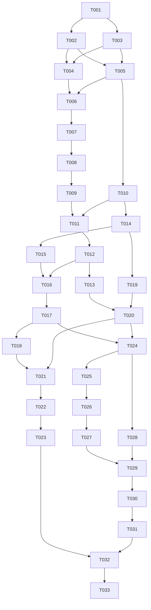

# Tasks: RealCheck System — baseline trước họp nhóm

**Input**: [spec.md](spec.md), [plan.md](plan.md), constitution và `.github/CODEOWNERS`.  
**Status**: Checklist triển khai, chưa đánh dấu hoàn thành chỉ từ việc có tài liệu.  
**Created**: 2026-11-01.

## Quy ước thực hiện và nghiệm thu

- Header có `[T00X] [Thư mục] [Owner]`; Owner là **review owner theo rule CODEOWNERS**, không phải khẳng định owner đó trực tiếp viết mọi module. Người thực hiện chuyên môn ghi trong từng task.
- `/data/`, `/streamlit/`, `/nginx/` và root/`.specify/` có `@Lucius-Ho`. `/app/`, `/models/`, `/.github/`, `/tests/`, `/locust/`, `/scripts/`, `/docs/` có `@Lucius-Ho @AIVIETNAM-AIO-ThanhLoan`.
- Task đa đường dẫn liệt kê từng tập owner; tác giả không tự approve. Đổi cách chạy phải sửa README tương ứng cùng PR. Giữ nhánh feature, ci-ok và ít nhất một approval độc lập.
- Mọi DoD là lệnh/kiểm chứng **sẽ chạy sau khi triển khai task**, không tuyên bố script/test đã tồn tại. Contract CLI, exit codes và vị trí file được định nghĩa trong plan mục 11. Không dùng `--help` hay kiểm tra file tồn tại đơn thuần thay kiểm nghiệm hành vi.
- Chạy từ repo root trong venv Python 3.11 đã cài requirements; lệnh Docker cần môi trường lab. Mỗi lệnh phải exit 0 trừ ca negative có test assert exit khác 0. Không thêm `|| true` để làm xanh.
- Unit/contract fixture nhỏ phải viết cùng implementation ở Phase 1/2; Phase 3 mở rộng và nghiệm thu độc lập. Đạt một phase không tự đồng nghĩa đạt toàn bộ core.
- Production tasks phụ thuộc quyết định D-ID chỉ nghiệm thu khi có giá trị đã ký. **[NEEDS CLARIFICATION - Chờ chốt buổi họp]**: D01–D14, mỗi ID có 2–3 phương án trong spec/plan. Trước họp có thể làm tests/interface với fixture profile; không dùng số thử nghiệm làm production defaults.
- Tất cả evidence lưu `artifacts/` gồm commit/config hash, output command, JUnit/report; report nhỏ đã sanitize đưa `docs/reports/`. Chưa có evidence thì checkbox giữ trống.

## Phase 1 — Setup & Data/Models Pipeline

Mục tiêu: thống nhất nguồn yêu cầu, tạo shared preprocessing và dataset/model đã được QA kiểm chứng, không huấn luyện trên dữ liệu chưa qua gate metadata.

- [ ] **[T001] [.specify/, /data/, /docs/] [Owner: @Lucius-Ho; /docs/: @Lucius-Ho @AIVIETNAM-AIO-ThanhLoan]**: Lực cập nhật constitution, `data/README.md`, `docs/test-plan.md` TC-17 và nguồn liên quan: bỏ gate dung lượng file, thay raw/post metadata audit A_eff ≤0.55, thêm crop/resize trước nén và score nội tại. Ghi điều khoản mới do người dùng yêu cầu, không gán AUROC 0.55 cho bài báo. Giữ nguyên trách nhiệm `/tests/`, `/locust/`, 15 test và coverage 70%; tăng version constitution theo quy tắc thay nguyên tắc tương thích. Mời Loan/Quang/Kiệt review thay đổi nghiệp vụ liên quan.
  
  *Dependencies:* Không; đây là task đầu tiên giải quyết xung đột nguồn yêu cầu.  
  *Definition of Done (DoD):* `git diff --check`; `rg -n '0\.55|metadata|score\(image\)' .specify/memory/constitution.md data/README.md docs/test-plan.md` hiển thị đủ quy tắc mới; `rg -n '15|70%|Locust' .specify/memory/constitution.md` xác nhận gate cũ liên quan QA được giữ. Review diff xác nhận không còn baseline dung lượng file là điều kiện nghiệm thu có hiệu lực, lịch sử thay thế được ghi rõ.

- [ ] **[T002] [/docs/, /scripts/] [Owner: @Lucius-Ho @AIVIETNAM-AIO-ThanhLoan]**: Quang chủ trì, từng thành viên chốt D01–D14 trong `docs/decisions/realcheck-baseline.md`: Loan D01/D03/D04, Kiệt D02/D08, Quang D05–D07/D11–D13, Lực D09/D10/D14. Tạo schema decision và `scripts/validate_config.py`; ghi state proposed/approved, người quyết định/reviewer, lựa chọn, rationale, ngày và ảnh hưởng. SLO chỉ ký sau baseline, decision D09/D10 trước đó có thể ở state measurement-required, không giả approved.
  
  *Dependencies:* T001.  
  *Definition of Done (DoD):* `python -m scripts.validate_config --scope meeting --decisions docs/decisions/realcheck-baseline.md` xác nhận đủ D01–D14 và 2–3 phương án/owner mỗi câu chưa quyết. `pytest tests/test_config.py -q` xác nhận production scope từ chối thiếu quyết định bắt buộc, budget sai thứ tự và unknown field; meeting scope không biến câu hỏi thành số mặc định. Biên bản có quyết định preprocessing/data/API để các task production phụ thuộc bắt đầu.

- [ ] **[T003] [/, /tests/] [Owner: /: @Lucius-Ho; /tests/: @Lucius-Ho @AIVIETNAM-AIO-ThanhLoan]**: Quang và Lực khai báo `requirements.txt`, `requirements-dev.txt`, cấu hình Ruff/pytest markers Python 3.11, package imports và artifact gitignore. Tạo fixture profile riêng dưới `models/fixtures/` (review model owners tương ứng) và helper fixture/test config, không tải CLIP trong collection. Phân biệt unit/data/integration/real_model; dependency lock ghi codec/library version để parity tái lập.
  
  *Dependencies:* T001, T002 (schema decision và config validator; chưa cần D09/D10 được ký vì dùng fixture profile rõ ràng).  
  *Definition of Done (DoD):* `python -m pip install -r requirements.txt -r requirements-dev.txt`; `ruff check .`; `ruff format --check .`; `pytest tests/test_config.py -q`; `pytest --collect-only -q` thu được test hữu ích, không tải trọng số, không cần network. `git check-ignore artifacts/example.csv` xác nhận output lớn bị ignore.

- [ ] **[T004] [/data/] [Owner: @Lucius-Ho]**: Loan lập nguồn GenImage/CIFAKE và raw manifest, checksum, nhãn, generator và `group_id`; giữ raw bất biến. Chọn D01 để sinh `data/prepare_config.json`, chia train/val/test chống exact/near-duplicate, gộp ảnh thật lặp từ các subset; external phone/AI-new/Zalo tách cohort đánh giá, không dùng train. Ghi số ảnh thực tế, giấy phép/nguồn học tập và exclusions. Tạo các ca schema/split của `tests/test_data.py` cùng task; đường dẫn test có review owners của `/tests/`.
  
  *Dependencies:* T002 (D01), T003.  
  *Definition of Done (DoD):* `pytest tests/test_data.py -q -k 'manifest or split or duplicate or labels'` pass trên fixtures có duplicate gài sẵn và nhãn sai; test phải reject các mẫu sai. Chạy cùng config hai lần qua entrypoint chuẩn bị được T006 bổ sung rồi kiểm lại T009; bước này nghiệm thu schema/split bằng test, chưa tuyên bố dataset canonical hoàn chỉnh.

- [ ] **[T005] [/models/, /tests/] [Owner: @Lucius-Ho @AIVIETNAM-AIO-ThanhLoan]**: Kiệt viết `models/preprocessing.py`, `NormalizationProfile`, canonicalize và tensor builder dùng chung. Theo D02: decode/orientation/RGB → crop/resize cùng kích thước → JPEG encode chung QF/subsampling → decode → CLIP preprocessing. Chặn encode trước geometry, không dựa nhãn/filename, không random serving crop, không có cờ upload tự khai đã chuẩn hóa. Lực viết test order, modes, raw 4000×3000 và PNG không JPEG history.
  
  *Dependencies:* T002 (D02/D07), T003.  
  *Definition of Done (DoD):* `pytest tests/test_preprocessing.py -q` pass, gồm spy order và assert 1 encode/call; fixture phone thực decode đủ 4000×3000 trong policy, PNG/RGBA/grayscale/EXIF-rotation xác định. Profile sản xuất có đủ tham số/version/hash, fixture profile được ghi riêng, không tuyên bố crop tự xóa mọi Double JPEG.

- [ ] **[T006] [/scripts/, /data/] [Owner: /scripts/: @Lucius-Ho @AIVIETNAM-AIO-ThanhLoan; /data/: @Lucius-Ho]**: Loan viết `prepare_data.py` dùng shared canonicalizer, lưu processed audit, metadata raw/post riêng, labels và lineage JSONL. Đọc metadata thực từ raw trước biến đổi và canonical bytes sau biến đổi. Không thêm filesize/path/source vào features; không làm lại raw; cache/output được version theo profile hash. Production configs đã chốt, pipeline lỗi có exit code và danh sách reject.
  
  *Dependencies:* T004, T005.  
  *Definition of Done (DoD):* `python -m scripts.prepare_data --config data/prepare_config.json --profile models/preprocessing.json --output data/manifest.jsonl`; `pytest tests/test_data.py tests/test_preprocessing.py -q` pass. Manifest liên kết đủ raw/processed và raw/post metadata, hash trước/sau của raw không đổi, cùng parent không rải split; train filepath còn trỏ raw, không processed.

- [ ] **[T007] [/scripts/, /tests/] [Owner: @Lucius-Ho @AIVIETNAM-AIO-ThanhLoan]**: Loan triển khai `metadata_audit.py` theo D03/D04; Lực viết độc lập `check_audit.py` và harness tests. Probe raw/post fit trên audit-train, chọn validation, test cohort khóa; whitelist metadata không pixels/embeddings/bytesize/path/provenance. Tính A_eff, bootstrap CI, overall/generator slices đủ count, negative/positive controls, report protocol/hash/score từng mẫu; constant features phải được ghi và kiểm controls.
  
  *Dependencies:* T002 (D03/D04), T003, T006.  
  *Definition of Done (DoD):* `pytest tests/test_metadata_audit.py -q` pass các biên 0.55/0.550001/A=0.1, one-class/NaN/missing/constant, positive control ≥0.95 bị gate chặn và negative control ≤0.55; tests xác nhận 0.550001 exit khác 0. `python -m scripts.metadata_audit --manifest data/manifest.jsonl --protocol data/audit_protocol.json --output artifacts/metadata-audit.json` tạo đủ raw/post và slices, không dùng filesize classifier.

- [ ] **[T008] [/data/, /scripts/] [Owner: /data/: @Lucius-Ho; /scripts/: @Lucius-Ho @AIVIETNAM-AIO-ThanhLoan]**: Loan chạy kiểm định GenImage chính, điều tra sai lệch post metadata và pixel/JPEG risks còn lại. Nếu gate fail thì version lại pipeline/dataset/protocol có rationale và dữ liệu kiểm định phù hợp, không xóa slice hay điều chỉnh nhãn để pass. Raw AUROC cao phải giữ báo cáo, không bắt raw ≤0.55; post threshold là cứng.
  
  *Dependencies:* T006, T007.  
  *Definition of Done (DoD):* `python -m scripts.check_audit --report artifacts/metadata-audit.json --max-auroc 0.55` exit 0, mọi registered valid post slice/probe A_eff ≤0.55 và controls hợp lệ; báo cáo có raw AUROC, CI, counts, extractor/protocol hashes. Chưa đủ mẫu/hai lớp là invalid và task chưa xong, không skip.

- [ ] **[T009] [/tests/, /docs/] [Owner: @Lucius-Ho @AIVIETNAM-AIO-ThanhLoan]**: Lực QA độc lập Loan: chạy lại prepare/audit từ raw trên môi trường khóa khác, so seed/split/profile/checksum processed, kiểm leakage ảnh cha và thay TC-17 bằng test metadata mới. Ghi sign-off dataset trong `docs/reports/data-qa.md`, phát hiện sai thì mở bug theo template; Kiệt chưa train chính thức trước sign-off.
  
  *Dependencies:* T008.  
  *Definition of Done (DoD):* `python -m scripts.prepare_data --config data/prepare_config.json --profile models/preprocessing.json --output artifacts/qa/manifest.jsonl`; `python -m scripts.metadata_audit --manifest artifacts/qa/manifest.jsonl --protocol data/audit_protocol.json --output artifacts/qa/metadata-audit.json`; `python -m scripts.check_audit --report artifacts/qa/metadata-audit.json --max-auroc 0.55`; `pytest -m data tests/test_data.py -q` pass. Report ghi môi trường QA, 0 group overlap, hash/row-order so khớp; người xác nhận khác Loan.

- [ ] **[T010] [/models/, /tests/] [Owner: @Lucius-Ho @AIVIETNAM-AIO-ThanhLoan]**: Kiệt viết feature extractor từ raw và `models/scoring.py` API `score(image) -> float`, load bundle riêng; dùng cùng tensor builder với train. Lực viết `test_parity.py`/`test_score.py` kiểm canonicalizer đúng một lần, RGB tensor, profile mismatch, LR classes label=1 và NaN/Inf/range. Chặn đường train đọc processed rồi normalize lại. Test dùng encoder stub nhưng preprocessing thật.
  
  *Dependencies:* T005, T003; interface/tests có thể làm song song audit, nhưng chưa train/publish trước T009.  
  *Definition of Done (DoD):* `pytest tests/test_parity.py tests/test_score.py -q` pass: exact tensor equality từ cùng raw/profile/runtime, cache invalidation profile đổi, 4000px/PNG pipeline thực, finite float và reject invalid score. Test chứng minh caller không cần preprocess và API adapter tương lai không thêm normalize lần hai.

- [ ] **[T011] [/models/, /scripts/] [Owner: @Lucius-Ho @AIVIETNAM-AIO-ThanhLoan]**: Kiệt triển khai `train_probe.py`, trích xuất CLIP frozen vector 512 từ raw bằng shared primitive; LR train trên train, tuning validation, classes/feature normalization ghi bundle. Cache key gồm raw/profile/CLIP/dependency hash. Train tool kiểm audit pass trước train, từ chối profile không khớp hoặc sử dụng model-test để chọn tham số.
  
  *Dependencies:* T009, T010, T002 (D08).  
  *Definition of Done (DoD):* `python -m scripts.train_probe --manifest data/manifest.jsonl --profile models/preprocessing.json --audit artifacts/metadata-audit.json --output models/clip_probe.joblib`; `pytest tests/test_score.py tests/test_parity.py -q` pass. Training log không có model-test tuning; bundle lưu class mapping, dims512, seed/profile/audit/train hashes, validation metrics và thresholds; không commit weights/features nặng.

- [ ] **[T012] [/models/, /scripts/] [Owner: @Lucius-Ho @AIVIETNAM-AIO-ThanhLoan]**: Kiệt và Quang hoàn thiện `bundle.py`, `verify_bundle.py`, revision pin/checksum, load/warmup một lần mỗi worker và artifact provisioning offline. Tạo test real-model marker kiểm JPEG/PNG/phone raw, model eval/no-grad; thiếu artifact không được đánh pass release. Benchmark stage normalization/CLIP/LR, threads1/2 và RAM cho D12.
  
  *Dependencies:* T011.  
  *Definition of Done (DoD):* `python -m scripts.verify_bundle --manifest models/model_manifest.json`; `pytest tests/test_real_model.py -m real_model -q`; `python -m scripts.benchmark_model --model-manifest models/model_manifest.json --manifest data/manifest.jsonl --samples 100 --output artifacts/model-benchmark.json`. Check count load=1/worker, ready chỉ sau warmup, corrupted manifest/profile bị reject, real scores finite; báo benchmark không giả thành client latency.

- [ ] **[T013] [/scripts/, /docs/] [Owner: @Lucius-Ho @AIVIETNAM-AIO-ThanhLoan]**: Loan viết `evaluate.py` metrics toàn tập và báo cáo uncertainty, Kiệt khóa model/threshold sau validation, Lực kiểm công thức. Chuẩn bị đánh giá test chính thức một lần khi model bundle đã khóa; nếu Accuracy <90% ghi fail, không chọn lại threshold trên test. Tạo fixture toán học cho confusion matrix, zero-denominator và Chưa chắc.
  
  *Dependencies:* T012, T002 (D08).  
  *Definition of Done (DoD):* `pytest tests/test_evaluation.py -q`; `python -m scripts.evaluate --manifest data/manifest.jsonl --model-manifest models/model_manifest.json --split test --output artifacts/evaluation.json`. Output có N/split/model/profile/threshold/hash, Accuracy/Precision/Recall/confusion/uncertainty; ≥0.90 mới quality-pass, thấp hơn vẫn lưu evidence nhưng task release quality chưa đạt. Không bỏ mẫu Chưa chắc khỏi binary metric toàn tập.

**Checkpoint Phase 1**: dataset đã QA độc lập, gate metadata pass, shared score không skew, bundle kiểm được. MVP API mock ở Phase 2 có thể làm song song T008–T013, nhưng chỉ tích hợp model phát hành sau T012.

## Phase 2 — Backend `/app/` & UI `/streamlit/`

Mục tiêu: luồng HTTP/UI đầy đủ, CPU execution bounded, phản hồi thành công và lỗi có contract. Localhost có thể chưa Nginx; nghiệm thu server qua Phase 3.

- [ ] **[T014] [/app/] [Owner: @Lucius-Ho @AIVIETNAM-AIO-ThanhLoan]**: Quang viết app factory/lifespan, settings, response/error/health schemas, routes health/docs/openapi và `verdict.py`. Chốt D05 mapping enum/status, header request ID, reason tiếng Việt; hai biên 0.3/0.7 thuộc Chưa chắc, EXIF không thay verdict. Test contract với model stub từ đầu.
  
  *Dependencies:* T002 (D05), T003, T010.  
  *Definition of Done (DoD):* `pytest tests/test_api.py -q -k 'schema or health or verdict or exif or openapi'`; `ruff check app`; `ruff format --check app`. Đủ 6 ca score biên AC-02 đúng, bad score fail, error envelope nhất quán cả RequestValidationError, health không gọi CLIP.

- [ ] **[T015] [/app/, /tests/] [Owner: @Lucius-Ho @AIVIETNAM-AIO-ThanhLoan]**: Quang triển khai bounded multipart một file, `limit+1` byte check, actual content format/header pixel/multi-frame safety và upload cleanup. Đọc EXIF whitelist từ raw trước canonicalizer xóa metadata, sanitize, không lộ GPS/serial. Không resize/re-encode trong route; bảo đảm score nhận raw bytes. Lực viết test missing/empty/fake/corrupt/oversize/PNG/phone.
  
  *Dependencies:* T014, T005, T002 (D06/D07).  
  *Definition of Done (DoD):* `pytest tests/test_api.py tests/test_errors.py -q -k 'upload or missing or corrupt or oversize or pixel or frame or exif or phone or png'` pass. Missing/fake image model call count 0, byte=limit chấp nhận nếu hợp lệ, +1 trả413, pixel bomb không allocate vượt giới hạn, không để temp files sau lỗi.

- [ ] **[T016] [/app/, /tests/] [Owner: @Lucius-Ho @AIVIETNAM-AIO-ThanhLoan]**: Quang viết `InferenceService` adapter theo D12; tách CPU decode/score ra khỏi event loop, capacity hữu hạn, deadline, cancel/disconnect/shutdown. Giữ slot khi timed-out work vẫn chạy; với child process terminate/join trước replacement. Startup/profile mismatch không ready; fault injection chỉ test adapter. Lực viết fake clock/test concurrency và lifecycle.
  
  *Dependencies:* T014, T015, T012, T002 (D11/D12).  
  *Definition of Done (DoD):* `pytest tests/test_errors.py -q -k 'timeout or capacity or disconnect or shutdown or readiness or recovery'`. N+1 request không tăng queue vô hạn, health còn phản hồi, timeout không trả200, không release slot sớm; cleanup/recovery thực thi theo adapter đã chốt, model load không lặp mỗi request.

- [ ] **[T017] [/app/, /scripts/, /tests/] [Owner: @Lucius-Ho @AIVIETNAM-AIO-ThanhLoan]**: Quang tích hợp real `score` và request logging; Lực tạo `smoke_api.py` và fixture preparation sinh `artifacts/fixtures/phone.jpg`, `sample.png`, plus small real permitted samples. Ghi timing normalize/CLIP/LR/total, IDs/model/profile; không log ảnh/PII. Thử localhost với model thật, không hardcode label của một ảnh ngẫu nhiên.
  
  *Dependencies:* T012, T015, T016.  
  *Definition of Done (DoD):* `pytest tests/test_real_model.py -m real_model -q`; khởi chạy `uvicorn app.main:app --host 127.0.0.1 --port 8000`; ở terminal khác chạy `python -m scripts.smoke_api --base-url http://127.0.0.1:8000 --fixture artifacts/fixtures/phone.jpg` và `curl --fail http://127.0.0.1:8000/health`. Response đủ schema/finite score, log có request ID/timing nhưng không bytes/GPS; fixture generation được test setup tạo trước lệnh smoke.

- [ ] **[T018] [/tests/] [Owner: @Lucius-Ho @AIVIETNAM-AIO-ThanhLoan]**: Lực review tích hợp API/model, mở rộng regression train-serving qua HTTP. Capture tensor trước encoder với spy thật cho phone JPEG/PNG, khẳng định API không preprocess khác, profile/hash đồng nhất và đúng một canonicalize. Test EXIF stripped không làm flip verdict khi score stub cố định, invalid model output có lỗi xác định.
  
  *Dependencies:* T017, T010.  
  *Definition of Done (DoD):* `pytest tests/test_parity.py tests/test_api.py tests/test_score.py -q`; report AC-03–07,19,20 pass. Không thay canonicalizer bằng mock trắng khiến test không chạm resize/nén; không yêu cầu pixels khác vì lossy JPEG phải có score bằng PNG.

- [ ] **[T019] [/streamlit/, /scripts/] [Owner: /streamlit/: @Lucius-Ho; /scripts/: @Lucius-Ho @AIVIETNAM-AIO-ThanhLoan]**: Loan viết `api_client.py` và trang Kiểm tra ảnh: uploader, submit một lần, loading/disable button, preview/session state, clear old result khi đổi file, labels/reason/EXIF/giới hạn tiếng Việt. API base URL qua Nginx lúc deploy, HTTP stub lúc unit test; không import model/canonicalize UI, không cache ảnh chung hoặc tự retry POST. Lực tạo import-boundary checker.
  
  *Dependencies:* T014 (contract), T003; end-to-end cần T017.  
  *Definition of Done (DoD):* `pytest tests/test_ui.py -q -k 'upload or result or error or session or retry'`; `python -m scripts.check_ui_imports --path streamlit`. AppTest kiểm 200/uncertain/413/429/503/504/network, một click một POST, session isolation và kết quả cũ không hiển thị khi upload mới lỗi; HTTP timeout lấy config D11.

- [ ] **[T020] [/streamlit/, /docs/] [Owner: /streamlit/: @Lucius-Ho; /docs/: @Lucius-Ho @AIVIETNAM-AIO-ThanhLoan]**: Loan triển khai trang Kết quả đánh giá đọc JSON report sanitize read-only, biểu đồ confusion matrix, metric toàn bộ/decided-only tách rõ, uncertainty coverage, model/profile/dataset hashes và OOD. Missing report hiển thị chưa đo, không fake số90%. Cập nhật README UI và kịch bản localhost/demo.
  
  *Dependencies:* T013, T019.  
  *Definition of Done (DoD):* `pytest tests/test_ui.py -q -k 'evaluation or report or uncertainty'`; `python -m scripts.check_ui_imports --path streamlit`; `streamlit run streamlit/app.py` kiểm hai trang theo script demo. Báo cáo thiếu/sai schema không crash hoặc hiện số mẫu như số thực tế.

**Checkpoint Phase 2**: API localhost model thật và UI stub/real route sẵn sàng; upload raw phone có normalization nội tại; lỗi/timeouts có kiểm soát. Chưa có Nginx/tải thật không được tuyên bố server core đã nghiệm thu.

## Phase 3 — QA `/tests/`, Performance `/locust/` & `/nginx/`

Mục tiêu: đóng gói server, kiểm gateway và fault recovery, đủ test/coverage, audit + model quality + performance có evidence. Không đợi đến đây mới viết unit tests.

- [ ] **[T021] [/tests/, /.github/] [Owner: @Lucius-Ho @AIVIETNAM-AIO-ThanhLoan]**: Lực hoàn chỉnh unit/contract regression suite, pytest markers và CI lint/test/ci-ok. Bỏ skip skeleton theo `ls tests/test_*.py`; pytest zero collected/failure/coverage fail làm CI đỏ. Giữ PR/main triggers, concurrency và permissions tối thiểu. Upload JUnit/coverage, CI không tự tải data/CLIP nặng; real integration là gate release riêng.
  
  *Dependencies:* T018, T019, T020.  
  *Definition of Done (DoD):* `ruff check .`; `ruff format --check .`; `pytest -m 'not integration and not real_model and not data' --cov=app --cov-fail-under=70 --cov-report=xml:artifacts/coverage.xml --cov-report=term --junitxml=artifacts/unit.xml` pass, ít nhất15 ca core thực thi. Chạy PR workflow và lưu link ci-ok; chứng minh test fail/coverage<70 trên nhánh thử khiến check đỏ rồi phục hồi, không để test sai cố tình trong commit cuối.

- [ ] **[T022] [/tests/, /docs/] [Owner: @Lucius-Ho @AIVIETNAM-AIO-ThanhLoan]**: Lực chạy lại dataset QA/audit sau tích hợp, kiểm metadata-only classifier không ăn bytesize/provenance, raw/post đồng cohort và post gate không mean qua slice. Đối chiếu chuẩn hóa phục vụ với profile train/audit, controls/hash và manifest không đổi sau huấn luyện. Loan sửa dữ liệu nếu cần; người kiểm vẫn Lực.
  
  *Dependencies:* T009, T011, T018, T021.  
  *Definition of Done (DoD):* `pytest tests/test_metadata_audit.py tests/test_parity.py -q`; `pytest -m data tests/test_data.py -q`; `python -m scripts.check_audit --report artifacts/metadata-audit.json --max-auroc 0.55`. Có sign-off cập nhật và zero raw/processed/profile hash mismatch; fail một slice/NaN/thiếu dữ liệu chặn release.

- [ ] **[T023] [/scripts/, /tests/, /docs/] [Owner: @Lucius-Ho @AIVIETNAM-AIO-ThanhLoan]**: Loan/Kiệt bổ sung robustness evaluate JPEG90/70/50, Zalo, phone, AI-new, rotate/crop/downscale/brightness; Lực review test và số đo. Ảnh con giữ group cha, so flip rate/metric degradation, N và uncertainty theo từng cohort. Không gộp CIFAKE vào Accuracy GenImage hoặc ép mọi biến đổi phải giữ verdict.
  
  *Dependencies:* T013, T022.  
  *Definition of Done (DoD):* `python -m scripts.evaluate --manifest data/manifest.jsonl --model-manifest models/model_manifest.json --robustness --output artifacts/robustness.json`; `pytest tests/test_evaluation.py tests/test_real_model.py -q` với artifact thật được provisioning. Report có đủ cohort thực tế; cohort dự kiến chưa thu được phải đánh thiếu, task release chưa hoàn tất chứ không sinh metric giả.

- [ ] **[T024] [/, /nginx/] [Owner: @Lucius-Ho]**: Quang tạo Dockerfile API/UI và Compose core, model mount read-only, dependencies pin, private API/UI ports, Nginx public80. Cấu hình reverse proxy route API/docs/health trước UI, WebSocket, body budget/file limits, 10r/s/IP, 429, burst/Retry-After theo D13, proxy timeouts theo D11, error JSON theo D05. Root config áp catch-all; Lực review, có thể mời Loan độc lập nếu tác giả là Lực.
  
  *Dependencies:* T017, T019, T020, T002 (D05–D07/D11–D13).  
  *Definition of Done (DoD):* `docker compose config`; `docker compose build`; `docker compose up -d`; `docker compose exec nginx nginx -t`; `curl --fail http://localhost/health`; `python -m scripts.smoke_api --base-url http://localhost --fixture artifacts/fixtures/phone.jpg`. `docker compose ps`/network inspection xác nhận không publish8000/8501/Grafana; UI mở qua gateway, không gọi model trực tiếp.

- [ ] **[T025] [/tests/] [Owner: @Lucius-Ho @AIVIETNAM-AIO-ThanhLoan]**: Lực tạo integration Nginx thật: multipart overhead file=limit/+1, request body oversized, missing/corrupt/pixel bomb, burst429/Retry-After, XFF spoof không đổi client identity, docs/health routing. Test recovery bằng test-only execution adapter: hung task/deadline, busy, upstream down, capacity cleanup/restart. Không public route ép score/timeout.
  
  *Dependencies:* T024, T021.  
  *Definition of Done (DoD):* `pytest tests/integration/test_gateway.py tests/integration/test_recovery.py -m integration -q --base-url http://localhost` pass. Fixtures integration provision test-only adapter/container override trước run; config production không bật injection. Report AC-09/10/19–24 có status/body/slot/recovery evidence, không chỉ TestClient.

- [ ] **[T026] [/tests/, /streamlit/] [Owner: /tests/: @Lucius-Ho @AIVIETNAM-AIO-ThanhLoan; /streamlit/: @Lucius-Ho]**: Lực và Loan kiểm UI qua Nginx, WebSocket handshake, một upload phone và PNG thật, response/errors/status loading, shared-IP quota giữa nhiều session, không cũ/kết quả session khác. Document giới hạn per-IP nhìn thấy tại gateway; không hứa per-end-user nếu chưa xây identity tin cậy.
  
  *Dependencies:* T024, T025, T020.  
  *Definition of Done (DoD):* `pytest tests/test_ui.py -q`; `pytest tests/integration/test_ui_gateway.py -m integration -q --base-url http://localhost`; `python -m scripts.smoke_api --base-url http://localhost --fixture artifacts/fixtures/phone.jpg`. Ghi kiểm thử hai browser session và status khi upstream503/504 theo demo checklist, 0 dữ liệu cross-session.

- [ ] **[T027] [/nginx/, /docs/] [Owner: /nginx/: @Lucius-Ho; /docs/: @Lucius-Ho @AIVIETNAM-AIO-ThanhLoan]**: Quang triển khai core lên server lab theo commit/image digest khóa, firewall chỉ cổng cần thiết, TLS/tunnel theo D13, healthcheck, restart/rollback hướng dẫn. Tạo metadata máy đo và workload manifest để Lực dùng. Monitoring profile chưa phải gate; chưa chạy server thì không ghi completed chỉ vì Compose local xanh.
  
  *Dependencies:* T025, T026.  
  *Definition of Done (DoD):* Trên server chạy `docker compose config`, `docker compose up -d --build`, `docker compose exec nginx nginx -t`; trên máy kiểm thử đặt biến `REALCHECK_BASE_URL` bằng URL gateway lab thực được ghi trong biên bản T027; `http://localhost` chỉ dùng cho kiểm tra local; chạy `curl --fail "$REALCHECK_BASE_URL/health"` và `python -m scripts.smoke_api --base-url "$REALCHECK_BASE_URL" --fixture artifacts/fixtures/phone.jpg` từ máy khác. Ghi URL lab, commit/image digest, cấu hình CPU/RAM/ports và kết quả rollback rehearsal; không commit secret/IP nhạy cảm.

- [ ] **[T028] [/locust/, /scripts/] [Owner: @Lucius-Ho @AIVIETNAM-AIO-ThanhLoan]**: Lực viết Locust valid multipart/scenario smoke/load/stress/soak và rate-only riêng; input raw JPEG/PNG/phone, schema check200, `wait_time` cấu hình theo profile. Tạo CSV/HTML/sidecar event timings theo outcome để tính percentile riêng200 (CSV Locust tổng không đủ), metadata status breakdown, 200-only percentile/RPS, offered RPS và RSS; `check_performance.py` từ chối thiếu SLO được ký khi check release. Tạo unit test math/parser không cộng429 vào throughput thành công.
  
  *Dependencies:* T024, T021, T002 (D14; D09/D10 còn measurement-required).  
  *Definition of Done (DoD):* `pytest tests/test_performance_reporting.py -q`; `locust -f locust/locustfile.py --headless -u 1 -r 1 -t 1m --host "$REALCHECK_BASE_URL" --csv artifacts/smoke --html artifacts/smoke.html` từ máy khác sau khi export URL gateway thực. Smoke model thật có schema/finite200; sidecar ghi payload mix/config/hardware, 429/503/504 riêng, không coi một Locust exit0 tự chứng minh SLA.

- [ ] **[T029] [/locust/, /docs/] [Owner: @Lucius-Ho @AIVIETNAM-AIO-ThanhLoan]**: Lực đo baseline load warm trên server và rate-limit riêng. Chọn profile A hoặc B theo D14; các lệnh dưới dùng A đề xuất, chưa là SLA. Không pre-resize payload, traffic danh định dưới10r/s mỗi IP hoặc báo rõ gateway throttling. Kiểm client không là bottleneck, model thật và cache behavior công khai.
  
  *Dependencies:* T027, T028.  
  *Definition of Done (DoD):* Từ máy khác chạy `locust -f locust/locustfile.py --headless -u 5 -r 1 -t 5m --host "$REALCHECK_BASE_URL" --csv artifacts/baseline --html artifacts/baseline.html`; riêng `locust -f locust/rate_limit.py --headless -u 25 -r 25 -t 30s --host "$REALCHECK_BASE_URL" --csv artifacts/rate`. Baseline report đủ p50/p95/p99/RPS/status/CPU/RAM/worker/profile và health; rate-only quan sát429 mà không gọi đó là năng lực inference. Profile B nếu được chọn phải cập nhật lệnh/report, không sửa ngầm sau nhìn kết quả.

- [ ] **[T030] [/docs/, /scripts/] [Owner: @Lucius-Ho @AIVIETNAM-AIO-ThanhLoan]**: Lực và Quang dựa T029 ký D09/D10/D11/D12, tạo `docs/performance/slo.json` với target p95, RPS200, unexpected-error budget, memory-growth/recovery, warmup/workload/hardware reference và chữ ký reviewer. Chọn các phương án p951/2/5s, RPS1/3/5, error0.5/1/2%, RSS5/10/15% bằng dữ liệu; có thể chọn giá trị khác có rationale. Không viết “đạt SLA” chỉ vì thay SLA theo số đo cùng lần nghiệm thu.
  
  *Dependencies:* T029, T002.  
  *Definition of Done (DoD):* `python -m scripts.validate_config --scope production --decisions docs/decisions/realcheck-baseline.md` pass; `pytest tests/test_performance_reporting.py tests/test_config.py -q`; `python -m scripts.check_performance --csv-prefix artifacts/baseline --slo docs/performance/slo.json` tạo so sánh baseline nhưng ghi rõ lần baseline không là run xác nhận độc lập. Config mới làm đổi capacity/timeout phải rerun integration T025 trước tải xác nhận.

- [ ] **[T031] [/locust/, /tests/, /docs/] [Owner: @Lucius-Ho @AIVIETNAM-AIO-ThanhLoan]**: Lực chạy tải xác nhận độc lập với SLO đã ký, stress tăng bậc và recovery, soak; Quang theo dõi resource. Dừng tăng nếu memory gần limit/service không hồi phục, lưu failed stage thay vì xóa. D14 chốt soak30/60/120m, profile A/B; lệnh mặc định dưới là A30m. Báo 429 gateway và503 admission riêng, không bypass limiter bằng XFF giả.
  
  *Dependencies:* T030; T025 phải pass lại nếu SLO/config đã thay.  
  *Definition of Done (DoD):* Chạy `locust -f locust/locustfile.py --headless -u 5 -r 1 -t 5m --host "$REALCHECK_BASE_URL" --csv artifacts/load --html artifacts/load.html`; stress lần lượt `-u 10 -r 2 -t 2m`, `-u 25 -r 5 -t 2m`, `-u 50 -r 5 -t 2m` với prefix riêng; recovery `-u 1 -r 1 -t 2m`; soak `-u 5 -r 1 -t 30m` prefix riêng. `python -m scripts.check_performance --csv-prefix artifacts/load --slo docs/performance/slo.json` và tương tự soak pass đúng scope target; stress đánh giá rejection/recovery, không ép latency danh định ở quá tải. Lưu raw reports/resources và kiểm health sau run, không OOM/slot leak.

- [ ] **[T032] [/scripts/, /tests/, /docs/] [Owner: @Lucius-Ho @AIVIETNAM-AIO-ThanhLoan]**: Lực tạo `validate_release.py` và tập hợp bằng chứng trace AC-01–29: metadata post gate, real-model quality, unit≥15/coverage≥70, parity, integration, robustness và SLO đã ký. Script kiểm hashes cùng release, không dùng report model/profile cũ; báo đủ missing/fail, không nuốt exit. Các ca phụ thuộc D-ID chỉ green khi quyết định production đã chốt.
  
  *Dependencies:* T021, T022, T023, T026, T031.  
  *Definition of Done (DoD):* `pytest tests/test_release_validation.py -q` chứng minh missing audit/SLO/coverage, stale hashes, AUROC>0.55 và Accuracy<0.90 bị fail; `python -m scripts.validate_release --audit artifacts/metadata-audit.json --evaluation artifacts/evaluation.json --performance artifacts/load --slo docs/performance/slo.json` exit0 với evidence release thực. Có traceability AC → test/report → commit, không đánh checkbox khi chỉ có test mock hoặc file report rỗng.

- [ ] **[T033] [/docs/] [Owner: @Lucius-Ho @AIVIETNAM-AIO-ThanhLoan]**: Lực tổng hợp demo/báo cáo, Quang chuẩn bị deploy/rollback, Loan minh họa data/metadata/UI, Kiệt trình bày preprocessing/model. Kịch bản có ảnh điện thoại raw, AI, Chưa chắc, Zalo, `/docs`, Nginx429, số đo Locust và giới hạn mô hình. Quay video dự phòng; ghi raw/post audit khác nhau, không tuyên bố metadata gate chứng minh hết mọi shortcut. Monitoring nếu chưa làm phải ghi ngoài core.
  
  *Dependencies:* T032.  
  *Definition of Done (DoD):* `python -m scripts.smoke_api --base-url "$REALCHECK_BASE_URL" --fixture artifacts/fixtures/phone.jpg`; `python -m scripts.validate_release --audit artifacts/metadata-audit.json --evaluation artifacts/evaluation.json --performance artifacts/load --slo docs/performance/slo.json`; `git diff --check`. Tập dượt theo `docs/demo.md` có ảnh/báo cáo thật, video dự phòng và reviewer độc lập xác nhận không dùng mục tiêu làm số đo; đủ tài liệu bàn giao tái lập.

## Dependency graph và phân công triển khai

Danh sách Dependencies dưới mỗi task là nguồn đầy đủ; graph thể hiện đường găng chính, không bỏ điều kiện D-ID chỉ vì graph giản lược.

Phối hợp con người sau khi task nền sẵn sàng: Loan tập trung T004/T006–T008 và T013/T019/T020; Kiệt T005/T010–T012; Quang T014–T017/T024/T027; Lực T007 checker/T009/T018/T021–T033 QA. Khác người viết và reviewer theo CODEOWNERS luôn được duy trì. Task cùng sửa một file cần giao một người phối hợp để tránh xung đột; bảng này không phải chỉ dẫn tự spawn agent.

Điểm chốt trước họp: tài liệu hoàn chỉnh, D-ID/owner/phương án rõ. Điểm chốt sau họp: quyết định được ký, config production hợp lệ. Điểm chốt phát hành: mọi gate dữ liệu/model/test/tải có evidence độc lập, không chỉ ba file tài liệu tồn tại.
