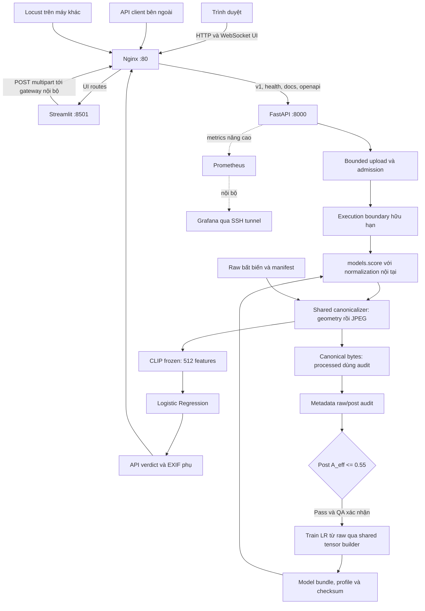
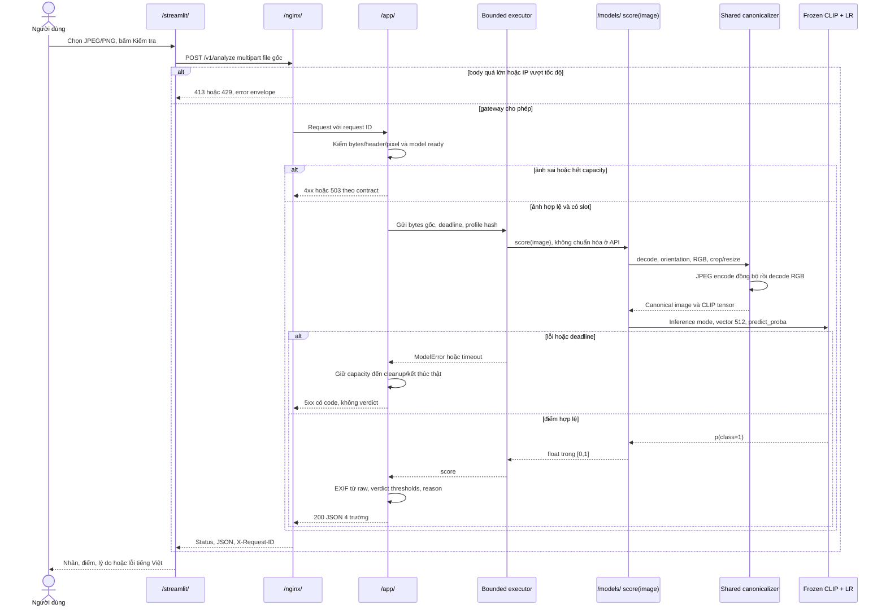

# Implementation Plan: RealCheck System — baseline trước họp nhóm

**Branch đề xuất**: `luc/realcheck-system-baseline` | **Date**: 2026-11-01 | **Spec**: [spec.md](spec.md).  
**Status**: Thiết kế để review, chưa là kết quả triển khai.  
**Input**: Yêu cầu toàn hệ thống, protocol chống metadata leakage, crop/resize trước nén và chuẩn hóa trong `score(image)`.

## 1. Technical Context và nguyên tắc quyết định

| Thuộc tính | Thiết kế baseline |
|---|---|
| Runtime | Python 3.11 theo CI hiện tại, Linux CPU server; local có Docker |
| API/UI | FastAPI, Uvicorn, Pydantic, python-multipart, Pillow; Streamlit + HTTP client |
| Model | PyTorch + transformers CLIP ViT-B/32 đóng băng, scikit-learn Logistic Regression, joblib |
| Storage | Filesystem cho raw/processed/features/manifests/model/reports; không thêm DB/Redis |
| Infra | Dockerfile API/UI, `docker-compose.yml`, Nginx cổng 80 cho demo lab; TLS theo D13 |
| QA | pytest, pytest-cov, HTTPX/TestClient, Streamlit AppTest, Ruff, Locust |
| Dependencies | Chốt và khóa phiên bản trong requirements runtime/dev và ghi codec/CLIP revision; không tự chọn latest ở runtime |
| Constraints cố định | Post metadata A_eff ≤0.55; ≥15 pytest core; coverage app ≥70%; IP limit 10r/s; file 5 MB; score finite `[0,1]` |
| Performance | p95/RPS/error/RSS/deadline còn mở theo D09–D12; benchmark trước SLA |

Mọi D-ID tham chiếu [Meeting Agenda](spec.md#11-danh-sách-câu-hỏi-kỹ-thuật-cần-chốt-trong-buổi-họp-nhóm-meeting-agenda). Cấu hình liên quan không có giá trị production ngầm; validator phải fail nếu profile production thiếu quyết định được ghi. Tests dùng profile fixture rõ ràng, không cần chờ họp để xác minh các bất biến.

## 2. Constitution Check

| Gate | Kết luận thiết kế trước triển khai |
|---|---|
| Phạm vi kiến trúc | Giữ FastAPI/CLIP+LR/Streamlit/Nginx/Compose; không mở rộng Redis/ONNX/ELA |
| Metadata thay dung lượng | **Có xung đột tài liệu cũ**; yêu cầu mới người dùng cho phép thay baseline, T001 sửa constitution/TC-17/README trước code. Không coi gate cũ còn hiệu lực song song |
| Nhãn/ngưỡng/EXIF | real=0/ai=1, ngưỡng mặc định 0.3/0.7, EXIF không ảnh hưởng verdict |
| Ranh giới chuẩn hóa | `models/preprocessing.py` dùng chung train và `score`, API/UI không chuẩn hóa riêng |
| Testing | AC-01–29 ánh xạ test; QA độc lập data; mock CI + real integration + tải riêng |
| Câu hỏi kỹ thuật | D01–D14 có owner/phương án; production profile và SLO chưa được tự phê duyệt |
| Review | CODEOWNERS theo đường dẫn và tác giả không tự approve; không nhầm owner reviewer với implementer |

Kiểm tra lại sau khi nhóm chốt D01–D14 và sau khi profile/dataset/model đầu tiên được khóa. Không ghi toàn bộ gate pass khi chưa có artifact/test hoặc còn profile production thiếu quyết định.

## 3. Kiến trúc hệ thống



Nginx là cổng public duy nhất; API không publish port 8000 trong cấu hình server, Streamlit không publish 8501. UI root qua Nginx; `/v1/`, `/health`, `/docs`, `/openapi.json` route API trước route `/` UI. Prometheus/Grafana qua Compose profile `monitoring`, không bắt buộc core. Khi Streamlit server gọi `http://nginx/v1/analyze`, không route trở lại UI vì prefix cụ thể ưu tiên.

### Sequence diagram của request



EXIF được đọc từ raw trước khi metadata bị xóa bởi canonicalizer, có thể làm cùng decode worker để tránh chi phí decode raster lần hai; không được đưa EXIF vào score hoặc thay đổi preprocessing theo Make/Model.

## 4. Project Structure — cấu trúc đích

Các file dưới đây là **sản phẩm phải tạo trong tasks**, không phải khẳng định hiện có. Ba tài liệu baseline ở `specs/000-realcheck-system-baseline/`; runtime code giữ cấu trúc repo cũ.

```text
app/
  main.py                 # app factory/lifespan, router, handlers
  settings.py             # typed env config và validate budgets
  schemas.py              # AnalyzeResponse, ErrorResponse, HealthResponse
  routes.py               # analyze, health
  uploads.py              # giới hạn bytes/header/format
  inference.py            # capacity/deadline/executor, không model math
  verdict.py              # thresholds/reason duy nhất
  logging.py              # request IDs, redaction, timings
models/
  __init__.py
  preprocessing.py        # profile, canonicalize, build_clip_tensor
  scoring.py              # load bundle, score(image), extract_features
  bundle.py               # schema/checksum/class mapping
  clip_probe.joblib       # ngoài Git nếu nặng
  model_manifest.json     # hash, version, metrics, lineage
  preprocessing.json      # profile đã chốt, không thiếu field
  clip/                   # weights/revision local, ngoài Git
  thresholds.json
  fixtures/preprocessing-test.json
scripts/
  prepare_data.py
  metadata_audit.py
  check_audit.py
  train_probe.py
  evaluate.py
  benchmark_model.py
  check_performance.py
  verify_bundle.py
  validate_config.py
  smoke_api.py
  validate_release.py
  check_ui_imports.py
  fixtures/               # metadata synthetic và profile kiểm thử nhỏ
  __init__.py
data/
  raw/
  processed/
  features/
  labels.csv
  manifest.jsonl
  metadata/raw.parquet
  metadata/post.parquet
  audit_protocol.json
  prepare_config.json
streamlit/
  app.py
  api_client.py
  pages/1_Ket_qua_danh_gia.py
nginx/
  nginx.conf
  errors/                 # nếu chọn error JSON tĩnh, không trace
locust/
  locustfile.py
  rate_limit.py
  README.md
  fixtures.json           # payload paths/weights, không chứa ảnh lớn
tests/
  conftest.py
  test_config.py
  test_evaluation.py
  test_performance_reporting.py
  test_release_validation.py
  test_preprocessing.py
  test_parity.py
  test_score.py
  test_metadata_audit.py
  test_data.py
  test_api.py
  test_errors.py
  test_ui.py
  test_real_model.py
  integration/test_gateway.py
  integration/test_recovery.py
  integration/test_ui_gateway.py
docs/
  decisions/realcheck-baseline.md
  performance/slo.json
  reports/                # báo cáo nhỏ đã loại dữ liệu cá nhân
artifacts/                # output thí nghiệm/HTML/CSV tạm, thêm gitignore
requirements.txt
requirements-dev.txt
pyproject.toml
Dockerfile
Dockerfile.streamlit
docker-compose.yml
.github/workflows/ci.yml
```

Ảnh test lớn sinh trong test hoặc lấy từ nguồn được phép; không commit data/model nặng. File artifact/code nhỏ chỉ commit khi không lộ path cá nhân hoặc metadata nhận dạng.

## 5. `/data/` — ingest, lineage và chuẩn hóa

### 5.1 Manifest và split

Loan lấy GenImage từ nguồn kế hoạch, lập raw manifest trước biến đổi. `sample_id` là định danh ổn định từ hash, `group_id` gộp raw duplicates và biến thể/ảnh cha. Cùng một ảnh thật lặp trong nhiều subset generator phải chung group. Hash bytes bắt exact duplicates; review near-duplicates bổ sung, không tuyên bố hash bytes phát hiện mọi ảnh crop/nén.

`labels.csv` tối thiểu `filepath,label,source,split`; `filepath` luôn trỏ raw trong train/evaluate. `manifest.jsonl` liên kết raw với processed, profile hash, label, group, generator. `source/generator` chỉ phân tầng/đánh giá, không feature detector/probe metadata.

**D01 [NEEDS CLARIFICATION - Chờ chốt buổi họp]**: 70/15/15 hoặc 80/10/10; seed 42 hoặc 2026; group và stratification theo class×generator. Model-test khóa sau chuẩn bị; audit-test từ development riêng theo D04 để chỉnh pipeline không lặp chọn theo model-test.

### 5.2 Một canonicalizer, một lần nén

Hợp đồng hàm chung trong `models/preprocessing.py`:

```python
canonicalize(raw_image, profile) -> CanonicalImage
build_clip_tensor(raw_image, profile, clip_processor) -> Tensor
```

`CanonicalImage` gồm decoded RGB sau JPEG, bytes JPEG canonical và profile hash. Hàm `build_clip_tensor` gọi `canonicalize` đúng một lần rồi CLIP processor. `score` gọi tensor builder; train feature extractor cũng gọi builder trên raw. `prepare_data` có thể gọi `canonicalize` để lưu processed cho audit, nhưng train không đọc processed rồi gọi builder lần nữa. Không dùng cờ `already_normalized` do người upload tự khai.

Thứ tự bất biến:

1. Validate bytes/header, thực decode trong bounded worker; kiểm pixel trước allocate, bắt decompression bomb.
2. Áp EXIF orientation đúng một lần, chuyển mode về RGB theo chính sách alpha/ICC đã chốt; không dùng EXIF trong feature.
3. **Crop/resize chung cho cả hai lớp, hoàn tất geometry trước JPEG encode**. Giữ trace tên bước ở test; ở production chỉ timing/profile, không log ảnh.
4. JPEG encode trong buffer, cùng QF/subsampling/progressive/optimize, không copy EXIF/ICC nhận dạng; decode lại thành RGB bằng cùng codec.
5. CLIP preprocessing cuối → tensor 224×224, đúng normalization mean/std của CLIP revision; không thêm pipeline class-specific.

**D02 [NEEDS CLARIFICATION - Chờ chốt buổi họp]**: target 224/256/512; geometry center-crop→resize hoặc resize-short-side→crop hoặc resize+pad; QF 90/95/100; subsampling 4:4:4 hoặc 4:2:0. Chọn interpolation bicubic hoặc Lanczos, alpha nền trắng hoặc đen và ICC giữ chuyển sRGB hoặc bỏ profile nhất quán. Fixture test profile dùng một lựa chọn khai báo rõ, không trở thành profile production tự động.

Geometry không bảo đảm xóa mọi lịch sử Double JPEG, đặc biệt crop trùng lưới 8×8 hoặc ảnh không thực đổi kích thước. Test thứ tự chỉ kiểm invariant code; audit metadata, robustness nén, score trên real/AI JPEG/PNG và đánh giá held-out mới kiểm hậu quả. Không báo “unbiased” tuyệt đối chỉ vì post header đồng nhất.

### 5.3 Metadata audit raw/post

Extractor đọc **bytes thực** của raw và canonical, không dựa extension. Raw table và post table là hai view riêng; metadata gốc được giữ làm provenance nhưng không lén ghép vào post features. Whitelist: format, width/height/ratio, mode/channels, alpha, EXIF presence/Make/Model được sanitize, quantization summary/JPEG table IDs/subsampling khi khả dụng. Không có file bytesize, path, source, generator, ID, label, train split trong input model.

Raw classifier đo mức độ có thể dự đoán nhãn từ nguồn gốc trước xử lý; raw AUROC cao là phát hiện hợp lệ, không chặn ingest. Post classifier đo từ metadata của output chuẩn hóa, gate **mọi probe và slice hợp lệ đăng ký trước** `A_eff <=0.55`. Raw không thể tự trở nên không thiên lệch bằng việc sửa báo cáo; nếu giữ metadata gốc sau biến đổi thì giá trị dự đoán đó vẫn không thay đổi. Hai view phải cùng sample cohort để so sánh.

**D03 [NEEDS CLARIFICATION - Chờ chốt buổi họp]**: LR regularized / Random Forest nông / HistGradientBoosting; chọn 1–2 probe trước test, preprocessing categorical/missingness fit trên audit-train. Với feature constant hoàn toàn, dùng constant score=0.5 có đánh dấu, vẫn bắt buộc controls để chứng minh extractor/probe hoạt động.

**D04 [NEEDS CLARIFICATION - Chờ chốt buổi họp]**: holdout audit 20% development / grouped 5-fold OOF / cohort độc lập. Đăng ký overall + generator slices có đủ hai lớp, tối thiểu 100 hoặc 200 mẫu mỗi lớp; bootstrap CI 1000 hoặc 2000 lần theo group. Thiếu lớp/count là `invalid`, không pass. Khoảng tin cậy chỉ mô tả bất định, hard gate dùng point A_eff. Max trên registered slices/probes, không mean. Statistical chance fail trên nhiều slice phải báo và điều tra, không tăng ngưỡng tự ý.

Báo cáo audit schema nghiệp vụ bắt buộc: `protocol_version`, config/hash manifest, probe/extractor versions, feature list, split counts/groups/classes, raw/post AUROC và A_eff mỗi slice, CI, invalid reasons, controls, `passed`. `check_audit.py` xác minh counts/hash/controls trước so ngưỡng không rounding; code exit 0 pass, 1 fail, 2 input/protocol invalid. Artifact này là điều kiện train/publish; báo cáo raw/post không được thay bằng ảnh chụp màn hình.

## 6. `/models/` — train, score và nạp model

### 6.1 Train và feature cache

Chạy prepare/audit → QA sign-off → trích xuất raw qua `build_clip_tensor` theo batch CPU → CLIP eval/inference mode → vector 512. **D02 [NEEDS CLARIFICATION - Chờ chốt buổi họp]**: L2-normalize vector hoặc giữ vector gốc; Kiệt benchmark trên validation rồi khóa trong profile bundle; nếu bật ở train phải bật ở score, không phụ thuộc thư viện mặc định. Cache key gồm raw hash, canonicalizer hash, CLIP revision, normalization policy và dependency/codec signature. Không dùng cache từ profile cũ.

Train LR trên train, chọn regularization và ngưỡng trên validation, xuất `classes_=[0,1]`, feature dimension. Không đánh giá model-test cho mỗi lần tune. Feature extraction complexity tuyến tính số ảnh `N` nhân chi phí CLIP; lưu batch, không giữ toàn bộ decoded ảnh trong RAM. Canonicalization time/space theo số pixel P có giới hạn; LR inference O(512), CLIP tensor kích thước cố định. Không gọi toàn pipeline O(1) khi còn decode ảnh 4000px.

**D08 [NEEDS CLARIFICATION - Chờ chốt buổi họp]**: metric threshold 0.5 hoặc validation-selected; vùng Chưa chắc 0.3/0.7 hoặc validation-selected cặp ngưỡng có mục tiêu false-positive/coverage. Báo confusion matrix binary toàn tập riêng với tỷ lệ Chưa chắc; không bỏ mẫu để đạt 90%.

### 6.2 Scoring contract

`models/scoring.py` cung cấp `load_bundle(path)` và `score(image) -> float`; nhận bytes/stream JPEG/PNG gốc, hoặc PIL Image còn EXIF theo documented adapter. Byte input là đường chuẩn cho API/train parity. Hàm top-level truy cập bundle đã khởi tạo cho worker, không load mỗi request. Pure primitive `extract_features` chia sẻ train/serve, không phụ thuộc FastAPI/Streamlit.

Logic: validate profile → build tensor (tự normalize) → CLIP image embedding, L2 theo bundle → LR `predict_proba` → lấy index label=1 qua classes → kiểm finite/range → `float`. Không clipping để che điểm lỗi. Contract streaming chỉ đọc tối đa byte budget; không nhận đường dẫn tùy ý từ request. Bộ canonicalizer và encoder được inject cho tests nhưng đường production luôn gọi chuẩn hóa nội tại. Raise `InvalidImage`, `UnsupportedImage`, `ProfileMismatch`, `ModelUnavailable`, `InferenceFailure` cho adapter map HTTP. `score` không trả verdict, lý do hoặc EXIF; `app/verdict.py` giữ logic kết luận.

Unit tests spy canonicalizer và fake encoder/LR; model integration thật kiểm feature shape, contract score và parity tolerance được D02 chốt. PNG và JPEG cùng cảnh nhưng pixels khác không bắt buộc score bằng nhau. Exact equality yêu cầu cùng raw bytes/profile/runtime tại tensor builder train/serve.

### 6.3 Lifecycle, artifact và optimization

Bundle manifest kiểm checksum, CLIP revision, codec/library versions, feature dimension, classes, profile hash, thresholds, training manifest hash, audit report hash. Joblib chỉ từ nguồn trusted, load read-only; không deserialize bất kỳ upload. CLIP weights tải trước deploy/mount, startup không phụ thuộc mạng Internet.

Lifespan nạp bundle, spawn/warm executor, warmup, rồi ready. Artifact thiếu/hash sai → không ready/khởi động fail rõ, không fallback model random. Inference mode/eval, batch=1 serving baseline, số CPU thread cấu hình để tránh oversubscription; benchmark 1 vs 2 worker rồi quyết định, không tăng worker theo số CPU một cách mù quáng vì mỗi worker nhân RAM model. ONNX/quantization không thuộc baseline.

## 7. `/app/` — HTTP contract, async và lỗi

### 7.1 Endpoints và schemas

| Endpoint | Input | Output / hành vi |
|---|---|---|
| `POST /v1/analyze` | multipart một `file`, JPEG/PNG bytes; filename untrusted | 200 AnalyzeResponse hoặc error envelope |
| `GET /health` | Không body | 200 `{"status":"ok","model_ready":true}`; 503 nếu chưa ready; không chạy inference |
| `GET /docs` | HTML | OpenAPI UI tự sinh |
| `GET /openapi.json` | Không body | Schema có giới hạn, enum/error definitions |
| `GET /metrics` | Nâng cao | Prometheus metrics nếu monitoring bật; không expose ảnh/source high-cardinality |

Mẫu response sau dùng **phương án A của D05 để minh họa**, chưa là enum đã ký:

```json
{
  "verdict": "likely_ai",
  "score": 0.87,
  "exif": "Không có thông tin máy chụp",
  "reason": "Điểm mô hình nằm trong vùng Ảnh AI. Ảnh không có thông tin máy chụp; đây chỉ là bằng chứng phụ."
}
```

Schema: verdict enum ba trạng thái; score finite constrained `[0,1]`; exif/reason nonempty strings; additional fields forbidden. Không làm tròn score để quyết định verdict; UI có thể format số. EXIF chỉ whitelist Make/Model hợp lệ và sanitize độ dài; lỗi đọc EXIF không làm ảnh hợp lệ fail. GPS, serial không trả ra ngoài.

```json
{
  "error": {
    "code": "MODEL_TIMEOUT",
    "message": "Phân tích quá thời gian cho phép. Vui lòng thử lại sau.",
    "request_id": "6e8c9d7d-e5dc-43a0-a59c-575e586684d8"
  }
}
```

**D05 [NEEDS CLARIFICATION - Chờ chốt buổi họp]**: enum A `likely_real/uncertain/likely_ai` hoặc B `real/uncertain/likely_ai`; schema lỗi envelope riêng như trên hoặc `detail` có cấu trúc thống nhất. Bảng mapping đề xuất: missing/multiple file 422; empty/corrupt 400 hoặc 422; unsupported format/multi-frame 415; byte/pixel limit 413; not-ready/busy 503; timeout 504; internal invalid score 500. Chốt code/message/status với Quang/Loan/Lực, custom handler cho RequestValidationError để lỗi framework cùng contract.

`X-Request-ID` trả ở success/error, request ID client được kiểm format hoặc thay ID mới; không dùng header lạ làm field metric. File multipart phải kiểm số part, không âm thầm lấy file đầu trong nhiều file. Giới hạn toàn body ở gateway/parser và đọc file chunk bounded `limit+1`, không đọc toàn upload vô hạn. Kiểm Content-Length chỉ hỗ trợ; không thay kiểm bytes thực/chunked. Filename không dùng làm path trên server.

### 7.2 Async và kiểm soát capacity

Route `async def` chỉ xử lý I/O bounded, admission và await execution. Decode + normalize + CLIP + LR chạy ngoài event loop. Cấu trúc `InferenceService` có limit slot, lifecycle, clock injectable và result future. Khi đầy, mặc định thiết kế fail-fast 503 không queue; nếu nhóm chọn bounded queue phải ghi capacity/deadline trong D12. Không dùng Redis.

**D12 [NEEDS CLARIFICATION - Chờ chốt buổi họp]**:

- A: worker thread với semaphore; timeout ngừng đợi phản hồi nhưng **không hủy được CPU thread**. Giữ slot đến callback completion, không tái nạp model khi còn inference cũ. Nếu công việc treo thật thì worker unhealthy và supervisor restart sau shutdown grace; tránh mở thread thay thế liên tục.
- B: inference child process có model nạp sẵn; quá deadline terminate rồi join process, đánh not-ready trong lúc tạo/warm replacement. Parent không giữ heap CLIP của child; IPC request có bytes bounded, một slot/process; tránh spawn một process mỗi ảnh.
- Số slot tham khảo 1×1 / 1×2 / 2×1 tùy benchmark RAM/CPU. Với B phải kiểm clean exit/recovery; với A không được cam kết hard CPU cancellation.

Kiến trúc `InferenceService` và tests capacity/recovery cố định cho cả hai adapter; chọn adapter bằng quyết định D12, không ghép hai cơ chế chưa kiểm. Shutdown ngừng nhận request, drain theo grace, đóng upload/buffer và join executor; timeout/client disconnect không cho phép slot leak hoặc over-admit. Có test hai request nối tiếp khi request đầu timeout.

**D11 [NEEDS CLARIFICATION - Chờ chốt buổi họp]**: `MODEL_TIMEOUT` 5/10/20s, tổng `API_BUDGET` phải bao gồm upload/decode/inference/cleanup. Với thread, cleanup compute không nằm trong deadline phản hồi nhưng capacity vẫn giữ. `NGINX_READ_TIMEOUT > API_BUDGET`, `UI_READ_TIMEOUT > NGINX_READ_TIMEOUT` có margin; margin gợi ý 2 hoặc 5 giây. Connect timeout UI 2 hoặc 3 giây. Lưu số đã chốt vào settings validator; không hứa các số này như SLA trước đo.

### 7.3 File safety và observability

**D06 [NEEDS CLARIFICATION - Chờ chốt buổi họp]**: chọn file 5.000.000 hoặc 5.242.880 bytes; overhead body 64 hoặc 128 KiB. Cấu hình API đúng file bytes, Nginx đúng body bytes; oversized body bị chặn trước API, oversized file trong body budget bị API từ chối 413.

**D07 [NEEDS CLARIFICATION - Chờ chốt buổi họp]**: MAX_PIXELS 16/24/32 MP; MAX_SIDE 8192 hoặc 10000. Kiểm width×height không overflow, bắt Pillow bomb warning/error theo policy, không gọi full load trước dimension gate. JPEG 4000×3000 và PNG lossless trong limit phải qua được bước kiểm tra; chất lượng model thật không được đo bằng fixture toàn một màu.

Log JSON request_id/route/status/latency/admission_wait/normalize_ms/clip_ms/lr_ms/model_hash/profile_hash. Error nội bộ có trace trong log bảo vệ, user message không trace. Không log raw bytes/EXIF GPS/full path dataset. /health độc lập slot suy luận, log health có sampling nếu cần; không dùng prometheus làm dependency core.

## 8. `/streamlit/` và `/nginx/`

### 8.1 UI/UX

Trang Kiểm tra ảnh: hướng dẫn JPEG/PNG và giới hạn byte, uploader, preview chỉ trong session, nút submit; spinner, khóa submit khi đang gửi, thông báo lỗi có request ID. Không gọi API mỗi lần file_uploader rerun. Mỗi submit gắn fingerprint cục bộ; đổi file xóa kết quả cũ. Không dùng `st.cache_data` chung cho bytes ảnh hoặc result người dùng; không import scoring vào UI.

Kết quả có nhãn tiếng Việt, score hiển thị dạng điểm AI, lý do, EXIF phụ và câu giới hạn kết luận. Chưa chắc là trạng thái bình thường, không màu đỏ như lỗi. 413 hướng dẫn giảm dung lượng, 429 đợi, 503/504 thử sau; không tự POST retry, người dùng chủ động bấm lại. Chưa có model/report thì nói rõ chưa sẵn sàng, không sample fake verdict.

Trang Kết quả đánh giá đọc báo cáo JSON đã sanitize mount read-only: dataset/version/hash, model/profile, binary threshold, Accuracy/Precision/Recall/confusion matrix, uncertainty rate và OOD; không gọi suy luận lại từng lần mở trang. Missing report không crash. Test bằng AppTest + HTTP stub, integration kiểm route UI/WebSocket qua proxy bằng client thực khi triển khai.

### 8.2 Reverse proxy và identity

Cấu hình Nginx phải có upstream API/UI, `map $http_upgrade $connection_upgrade` cho WebSocket, route API trước UI, proxy HTTP/1.1, giới hạn body cho analysis, lỗi JSON theo D05. Rate zone key `$binary_remote_addr`, `rate=10r/s`, `limit_req_status 429`; áp cho analyze, không áp health cùng quota để health không báo giả down.

**Burst [NEEDS CLARIFICATION - Chờ chốt buổi họp], thuộc D13**: không burst hoặc burst 10 `nodelay` hoặc burst 20 có delay; lựa chọn ảnh hưởng acceptance rate test và queue latency. Nginx leaky bucket không có nghĩa chính xác chỉ 10 request được nhận ở mọi cửa sổ 1 giây; tests đối chiếu policy burst/interval đã chốt. Retry-After có thể giá trị gợi ý 1 hoặc 2 giây, ghi quyết định và test header.

Body budget/pixel không dùng syntax magic: config generator/validation từ settings đã chốt để không nới 5 MB vô ý. `proxy_read_timeout`/`proxy_send_timeout` từ D11; client body read timeout và số connection giới hạn hữu hạn, không đưa SLO chưa chốt vào config production.

Nginx xóa/ghi đè XFF từ public, không `set_real_ip_from 0.0.0.0/0`. API chỉ tin gateway network. Traffic Streamlit gọi từ container có chung source IP; baseline phản ánh shared quota. Nếu cần per-end-user quota, phải xây dựng identity/proxy path tin cậy rồi test spoofing, không lấy XFF từ form. Load danh định không dùng header giả để né limit; cần nhiều máy/IP thật nếu offered >10r/s/IP.

## 9. `/tests/` — chiến lược kiểm chứng của Lực

Tests tạo sớm cùng module dù Phase 3 là điểm hội tụ QA hệ thống. `pytest.ini` hoặc pyproject đăng ký `integration`, `real_model`, `data`, `gateway`, `slow`. Default CI chạy mọi test nhỏ không cần network/model; tests phụ thuộc môi trường bị deselect có chủ đích, report rõ; release job phải chạy nhóm tương ứng, missing artifact/env là fail chứ không skip để đạt.

| Test file | Nội dung bắt buộc / traceability |
|---|---|
| `test_preprocessing.py` | Geometry trước JPEG, mode/EXIF rotation, PNG alpha/grayscale, image bomb giới hạn, JPEG 4000×3000; AC-03/04/06/10/11/12 |
| `test_parity.py` | Raw bytes đi train/serve tạo tensor exact same, normalize một lần, không đọc processed để encode lại, hash khác làm invalid cache; AC-05 |
| `test_score.py` | Fake CLIP 512 dim, LR classes index, finite/range, bad bundle, load once, inference mode; AC-19/20 |
| `test_metadata_audit.py` | Whitelist cấm bytesize/path/source, raw/post extractor, positive/negative controls, gate 0.55/0.550001/A=0.1, NaN/one-class, group leakage; AC-13–17 |
| `test_data.py` | TC-11–16, raw immutability, lineage, no duplicate group, reproducible split/hash; AC-18 |
| `test_api.py`, `test_errors.py` | TestClient mock inference, response/schema/thresholds/EXIF/no model call invalid upload, timeout/capacity fake clock, startup failure; AC-01/02/07–09/19–22 |
| `test_ui.py` | AppTest stub success/error/uncertain/missing report, đổi file/session, one click one request; AC-29 |
| `test_real_model.py` | Artifact thật, score phone/PNG, feature shape/profile, parity tolerance; không phụ thuộc dự đoán đúng ảnh synthetic đơn lẻ |
| `integration/test_gateway.py` | Nginx thật: routing/body overhead/413/429/IP spoofing/JSON errors/health/docs, AC-09/23/24 |
| `integration/test_recovery.py` | Fault injection từ test-only adapter, deadline/cleanup/busy/recovery, worker restart; không public endpoint tiêm lỗi |
| `integration/test_ui_gateway.py` | HTTP client UI qua Nginx, WebSocket handshake, smoke một upload, không bypass gateway |

Ít nhất 15 ca hữu ích thực thi core; thực tế bảng trên đòi nhiều hơn 15. `pytest --cov=app --cov-fail-under=70` là gate app, không gộp models/data để bù app coverage. CI chạy `pytest -m 'not integration and not real_model and not data' --cov=app --cov-fail-under=70 --cov-report=xml:artifacts/coverage.xml --cov-report=term --junitxml=artifacts/unit.xml`; unit metadata fixture không đánh marker data nặng để vẫn chạy. `pytest -m data` là QA dataset thật; model thật và gateway chạy riêng release. Không thêm test chỉ để đếm đủ 15.

Fixture phone tạo JPEG 4000×3000 màu đa dạng hoặc mẫu được phép dưới byte limit; spy at canonicalizer và before-CLIP tensor để tránh test mock hết preprocessing. Test PNG cùng cảnh không đòi score giống JPEG đã lossy. Test corruption/bomb tránh allocate ảnh khổng lồ thật; test format dùng bytes header thực, không chỉ MIME.

QA độc lập chạy prepare từ raw trên máy khác cùng environment lock, so hash manifest/processed/profile. Báo lỗi theo `docs/bug-report-template.md`; báo raw metadata có thiên lệch không phải lỗi tool mà là phát hiện phải giữ.

## 10. `/locust/` — workload và cấu trúc hiệu năng

`locustfile.py` upload multipart hợp lệ, kiểm 200 đủ schema/finite score bằng `catch_response`; response 200 sai schema là failure. Input weights khai báo ở fixtures.json: JPEG GenImage, PNG, JPEG điện thoại ≤ byte/pixel budget; có thể dùng mix khảo sát 40/30/30 hoặc 50/25/25 (**D14 [NEEDS CLARIFICATION - Chờ chốt buổi họp]**). Ảnh truyền là raw để đo normalization thực, không pre-resize client.

Profile A dưới đây là **kịch bản thí nghiệm đề xuất có số cụ thể**, không SLA đã cam kết. Profile B: giảm một nửa user và thời lượng, giữ tối thiểu một user; D14 chọn A/B, soak 30/60/120 phút sau smoke an toàn. `wait_time` profile danh định khởi đầu 1–3s; không sleep cứng trong task, dùng Locust wait_time, report offered load thực. RPS phụ thuộc latency, user count không đồng nghĩa RPS.

| Scenario | Users | Spawn rate | Run time | Điều kiện và mục đích |
|---|---:|---:|---:|---|
| Smoke | 1 | 1/s | 1m | Model ready/warm; 200 schema đúng, pipeline chạy end-to-end |
| Load | 5 | 1/s | 5m | Đo p95/RPS/RAM máy chuẩn, traffic một IP dưới 10r/s hoặc báo 429 riêng |
| Stress-1 | 10 | 2/s | 2m | Bắt đầu tăng, xác định admission/cpu limit |
| Stress-2 | 25 | 5/s | 2m | Chạy sau Stress-1 ổn, theo dõi 503/429 riêng |
| Stress-3 | 50 | 5/s | 2m | Dừng tăng nếu memory gần limit hoặc recovery fail; ghi lý do dừng |
| Recovery | 1 | 1/s | 2m | Sau stress, so health và request thành công, slot không leak |
| Soak | 5 | 1/s | 30m | Sau load; đo RSS sau warmup, error/status distribution |
| Rate-only | 25 | 25/s | 30s | wait_time=0, một IP, fixture nhỏ/mock upstream trong test network nếu cần; chỉ chứng minh 429, không dùng công bố inference RPS |

Warmup thực hiện trước measurement, không xóa lỗi ở giữa run để làm đẹp số đo. Lưu percentile cho 200 và cho toàn traffic; successful RPS = số 200 schema hợp lệ / thời gian, offered RPS toàn request. Tách expected 429, busy503, timeout504, unexpected5xx và transport errors. Không đánh dấu 429 là success rồi tính nó thành throughput model.

Locust CSV mặc định gộp status theo request name nên không đủ để tính p95 riêng 200. Request event hook phải lưu thời lượng/status/schema-valid theo outcome vào sidecar histogram hoặc NDJSON, cùng interval timestamps; checker tính p95 nearest-rank trên 200 schema hợp lệ, không suy ra bằng cách trừ percentile của CSV tổng. Nếu thiếu sidecar thì check hiệu năng invalid. Server thu resource samples bằng `docker stats --no-stream --format '{{json .}}'` định kỳ với timestamps; đo RSS sau warmup và cuối soak trên cùng process/image.

Mỗi stage từ máy khác qua URL gateway; log hardware CPU/core/RAM/container memory/quota, git commit/image digest, worker/CPU threads, CLIP/profile/audit hashes, payload sizes/mix, exact command/start/end, Locust version/client CPU. Load generator cũng phải được kiểm không bão hòa.

**D09/D10 [NEEDS CLARIFICATION - Chờ chốt buổi họp]**: latency p95 1/2/5s; throughput 1/3/5 RPS; unexpected error budget 0.5/1/2%; RSS tăng sau warmup 5/10/15%. Chỉ sau baseline mới ký `docs/performance/slo.json` gồm workload/hardware reference và thresholds; checker refuse missing/unapproved SLO. Phân tích được báo cáo dù không đạt, không thay số SLA sau nhìn test chính thức.

## 11. `/scripts/` — CLI hợp đồng để DoD thực thi

Tất cả lệnh sau là CLI **phải được triển khai theo tasks**, không khẳng định hiện đã chạy. Từ repo root, dùng `python -m scripts...`; exit 0 đạt, 1 gate fail, 2 dữ liệu/config invalid. `--help` không tải model/dataset. Input path thực nằm trong config, không hardcode máy người viết.

| CLI | Hành vi / output |
|---|---|
| `validate_config --scope meeting --decisions docs/decisions/realcheck-baseline.md` | Kiểm mọi D-ID có owner/phương án hoặc quyết định; production scope yêu cầu giá trị được ký, schema và budget nhất quán |
| `prepare_data --config data/prepare_config.json --profile models/preprocessing.json --output data/manifest.jsonl` | Ingest/split/canonicalize, raw/post metadata, labels, hash/lineage; không train |
| `metadata_audit --manifest data/manifest.jsonl --protocol data/audit_protocol.json --output artifacts/metadata-audit.json` | Raw/post metadata-only probe, controls, slices, scores, AUROC/CI; không tải CLIP |
| `check_audit --report artifacts/metadata-audit.json --max-auroc 0.55` | Validate protocol/count/hash/controls; tất cả post A_eff <=0.55; fail invalid/NaN |
| `train_probe --manifest data/manifest.jsonl --profile models/preprocessing.json --audit artifacts/metadata-audit.json --output models/clip_probe.joblib` | Chặn audit fail, extract từ raw qua shared tensor builder, train/val only, xuất bundle manifest/thresholds |
| `verify_bundle --manifest models/model_manifest.json` | Check tất cả artifact/checksum/profile/class/revision; không chạy API |
| `evaluate --manifest data/manifest.jsonl --model-manifest models/model_manifest.json --split test --output artifacts/evaluation.json` | Model-test cuối theo threshold khóa; output Accuracy/precision/recall/confusion/uncertainty N |
| `evaluate --manifest data/manifest.jsonl --model-manifest models/model_manifest.json --robustness --output artifacts/robustness.json` | JPEG90/70/50, rotate/crop/resize/brightness và external cohorts có khai trong manifest; missing cohort ghi thiếu và release check fail nếu bắt buộc |
| `benchmark_model --model-manifest models/model_manifest.json --manifest data/manifest.jsonl --samples 100 --output artifacts/model-benchmark.json` | Warm/cold timings stage và memory, không gọi đó là end-to-end SLO |
| `smoke_api --base-url http://localhost --fixture artifacts/fixtures/phone.jpg` | Health/docs/analyze/schema; dùng file hợp lệ local đã chuẩn bị, không assume mọi ảnh phải được gọi thật |
| `check_performance --csv-prefix artifacts/load --slo docs/performance/slo.json` | Đọc CSV và sidecar run metadata, tách 200/error, check signed workload/hardware/SLO; không chấp nhận 429 làm RPS thành công |
| `check_ui_imports --path streamlit` | AST/import check UI không phụ thuộc models; exit khác 0 nếu bypass model contract |
| `validate_release --audit artifacts/metadata-audit.json --evaluation artifacts/evaluation.json --performance artifacts/load --slo docs/performance/slo.json` | Kiểm audit ≤0.55, Accuracy ≥0.90, hashes nhất quán, test report ≥15/coverage ≥70 từ `artifacts/unit.xml` và `artifacts/coverage.xml`, `artifacts/robustness.json` bắt buộc, signed SLO; missing evidence fail |

`artifacts/fixtures/phone.jpg` do test fixture preparation T017 tạo trước smoke/release; CLI và tests phải validate tên/input tồn tại. Những file model/metadata/config còn chờ họp không được tạo bằng placeholder null rồi coi setup đạt production.

## 12. CI, đóng gói và triển khai

CI hiện có lint/test/ci-ok nhưng điều kiện tìm `tests/test_*.py` có thể bỏ qua tests; khi triển khai phải bỏ skip hoặc dùng pytest collection recursive và fail nếu zero collected. Setup Python 3.11; cài dependencies khóa; Ruff check/format; unit/contract/mock parity/audit controls; pytest coverage app ≥70 và JUnit/coverage artifact; `ci-ok` fail nếu một job fail/cancel, không chỉ dựa exit shell được nuốt.

Model nặng và data audit không tải trong mọi PR. Release/test thủ công có trusted artifact chạy real-model/data/integration/Locust theo môi trường lab, upload report; CI unit xanh không thay thế sign-off release. Fault injection chỉ ở test config/build, không có public route điều khiển điểm/thời gian model.

Docker image non-root khi khả thi, model mount read-only, temp/upload giới hạn, healthcheck nhẹ. `docker compose config`, `docker compose build`, `docker compose up -d`, `docker compose exec nginx nginx -t` là gate infra. Chỉ Nginx publish 80; UI/API networks private. Secrets ngoài Git. Deploy server qua SSH thủ công theo kế hoạch; pin commit/image digest, kiểm `/health`, smoke, rollback image trước nếu fail. CD tự động để sau; không thêm workflow tự deploy vì chưa có yêu cầu.

Monitoring nâng cao chỉ sau core + baseline: Prometheus scrape nội bộ, Grafana SSH tunnel, RED metrics/timings/resource; không ghi nhãn metric theo filename/request ID. Nếu không kịp dùng Locust HTML + CSV, không chặn core vì thiếu Grafana.

## 13. CODEOWNERS, implementer và traceability

CODEOWNERS quy định reviewer đường dẫn, **không tự chuyển vai trò ML/Backend sang Lực**. Tất cả owner handles trong task header phải là tập chính xác khớp rule sau cùng:

| Đường dẫn | CODEOWNERS | Người thực hiện theo chuyên môn |
|---|---|---|
| `/app/`, `/models/`, `/.github/` | `@Lucius-Ho @AIVIETNAM-AIO-ThanhLoan` | Quang / Kiệt / Lực+Quang tương ứng |
| `/data/`, `/streamlit/`, `/nginx/` | `@Lucius-Ho` | Loan / Loan / Quang |
| `/tests/`, `/locust/`, `/scripts/`, `/docs/` | `@Lucius-Ho @AIVIETNAM-AIO-ThanhLoan` | Lực QA; script data Loan, script ML Kiệt; docs mỗi người viết phần mình |
| Root config, `.specify/` | `@Lucius-Ho` qua catch-all | Quang/Lực phối hợp |

Task chạm nhiều đường dẫn phải mô tả cả người thực hiện và các reviewer bổ sung áp dụng; không giả vờ catch-all thay explicit rule. Tác giả không tự approve, cần reviewer độc lập và ci-ok. Với đường dẫn chỉ có Lực nhưng Lực là tác giả, mời reviewer độc lập theo quy trình nhóm; không tuyên bố GitHub sẽ tự chọn owner khác không có trong file.

| Requirement/AC | Tasks |
|---|---|
| Tài liệu mới thay baseline cũ, decision registry | T001–T003 |
| FR-D01–08, AC-13–18 | T004–T009, T022 |
| FR-M01–06, AC-03–06/19/20/25 | T010–T013, T018, T023 |
| FR-A01–06, AC-01/02/07–12/19–22 | T014–T018, T021, T025 |
| FR-U01–02, AC-24/29 | T019–T020, T026 |
| FR-N01–03, AC-09/23 | T024–T027 |
| FR-Q01–05, AC-26–28 | T021–T023, T028–T033 |

## 14. Risks và Complexity Tracking

Không có microservice nghiệp vụ hoặc DB mới; executor boundary có lý do cụ thể là CPU inference không block HTTP và capacity khi timeout. Risks phải theo dõi: metadata post constant không chứng minh pixel bias sạch; audit cohort nhỏ có variance; crop có thể mất dấu vết AI/nội dung; profile thay đổi làm mọi cache/weights cũ không hợp lệ; phone pixels tốn RAM dù bytes nhỏ; Streamlit shared-IP khiến quota gộp; thread không hard-cancel. Các rủi ro có test/protocol/decision tương ứng, không được giải bằng score giả hoặc tắt QA.

Bản baseline hoàn chỉnh về luồng và trách nhiệm. Production config, metadata classifier và SLO vẫn cần nhóm thống nhất, ghi D01–D14; điều đó là giới hạn chủ ý của phiên bản trước họp, không phải nội dung bị bỏ trống.
